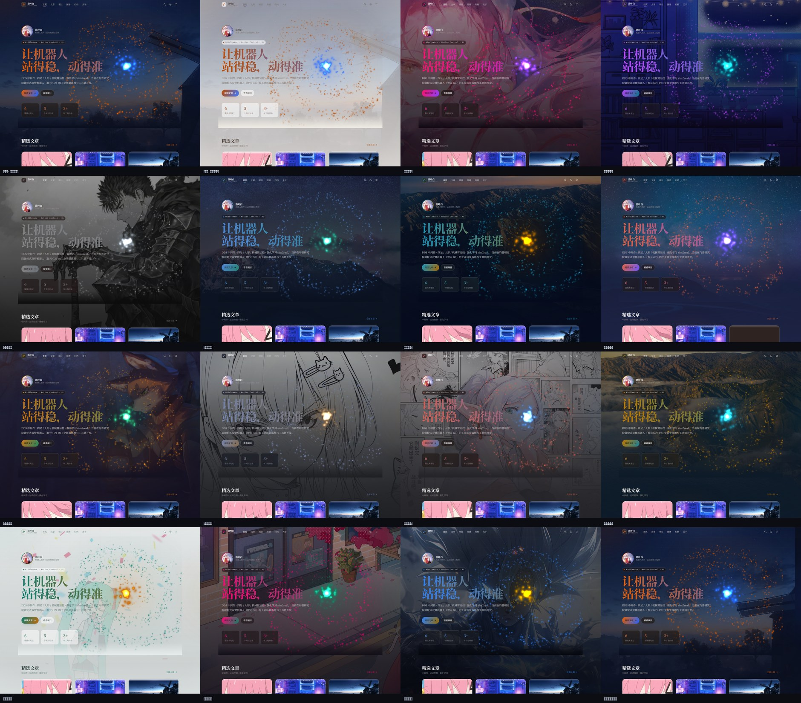
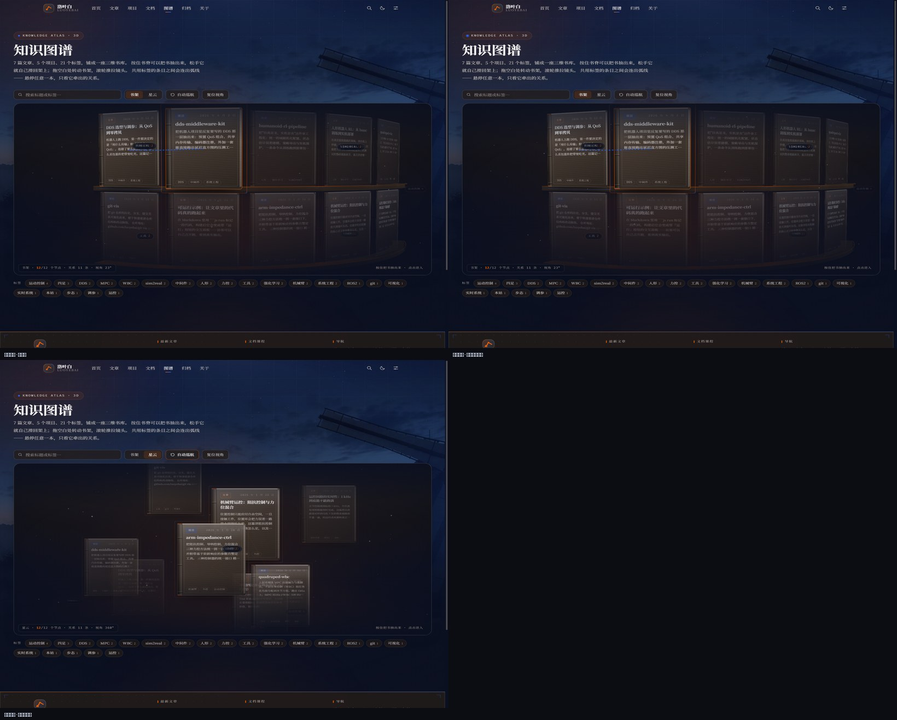
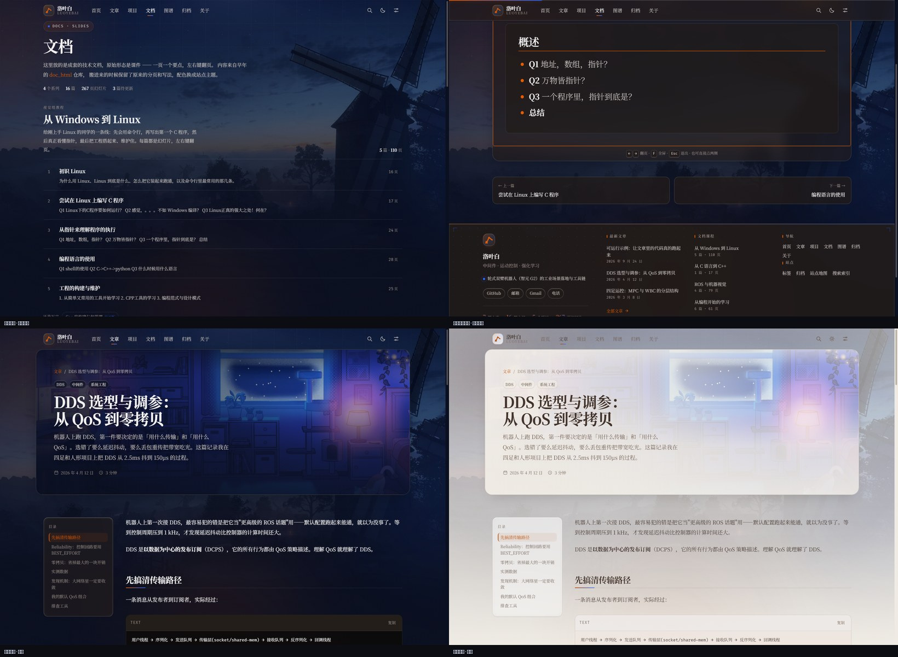
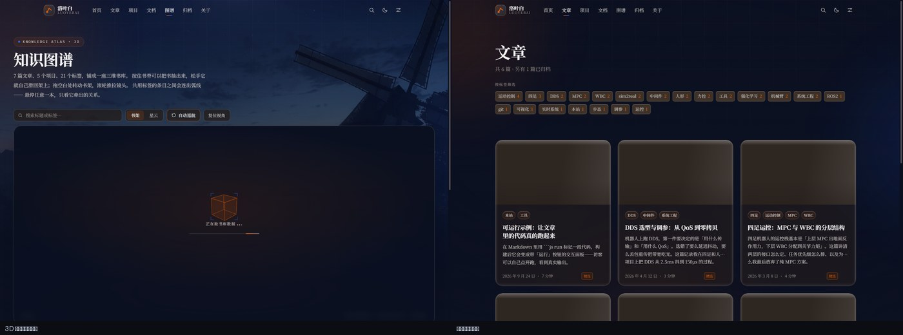
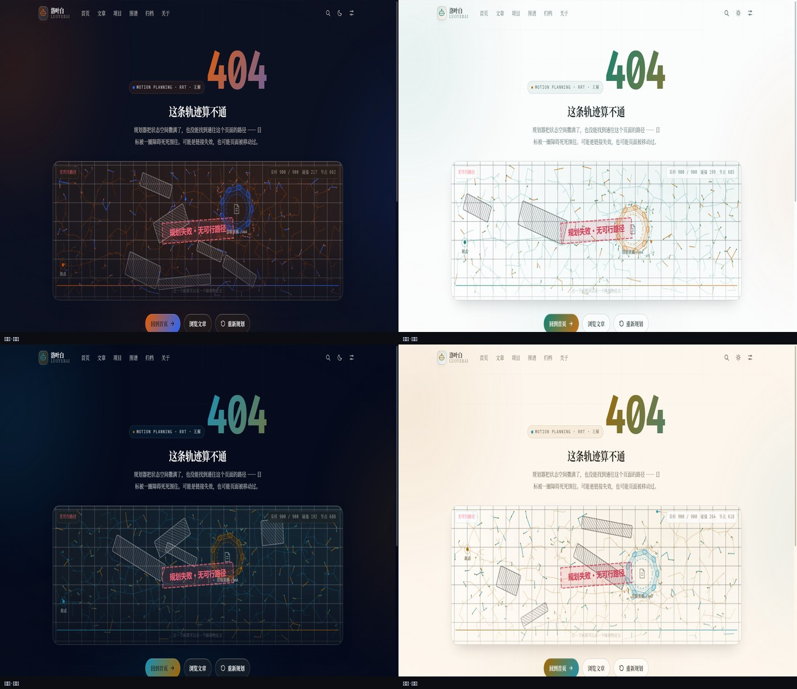

# 洛叶白 · 个人博客

机器人软件 / 运动控制工程师的个人站点。**Python 手写的静态站点生成器**——Markdown 解析、代码高亮、配色推导、模板引擎、写作后台全部在 `tools/` 里，核心构建与后台使用 Python 标准库。

方向：DDS 中间件 · 四足与人形运控 · 机械臂控制 · 强化学习 sim2real。











## 特性

**写作**
- 自带**图形化写作后台**（`python tools/admin.py`）：列表管理、Markdown 编辑 + 实时预览、封面选择与上传、草稿/归档/精选开关、一键构建
- 也可以直接写文件：一个 `.md` 放进 `content/posts/`，跑一条命令就发布
- front-matter 描述元信息，正文用 Markdown 子集（表格、任务列表、提示框、容器）
- **文档区 `/docs/`：成套的课件式文档**，一页一个要点、键盘翻页，见下文「文档区」
- 代码块自动语法高亮（16 种语言）+ 一键复制
- 数学公式用**本地化的 KaTeX** 渲染，**离线可用**
- 自动摘要、阅读时长、目录（TOC）、标签归档、上下篇、相关文章
- **外链带站点标记**：正文里指向 GitHub、ROS、Python、Bilibili 这些常去站点的链接，
  前面会带一枚品牌图标；整段只有一条外链时渲染成**链接卡片**，见下文「外链的站点标记」
- 输出站点地图、搜索索引（RSS 默认关闭，见下）

**封面**
- 文章/项目页的封面是**整块头图，标题直接压在图上**（不是图下面挂一行标题），遮罩按对比度校验过
- 支持在 front-matter 里指定裁切焦点（`coverPos`）；方图/竖图自动改成「完整显示 + 模糊填充」
- 卡片封面带 `width`/`height` 与懒加载，图片到达前不会整屏跳一下

**外观**
- **14 套主题**，每套配一张壁纸（+ 一段同名视频循环片），配色由种子色自动推导并做对比度校验
- 每套主题都有独立的**深色 / 浅色**两套 token，共 28 组配色
- 设置面板：主题、明暗、字体（无衬线/衬线/等宽）、阅读宽度、玻璃质感档位、壁纸开关与可见度/模糊、字号缩放、动效开关、强调色覆盖
- 设置存 `localStorage`，首屏内联脚本恢复，**无闪烁**
- URL 参数可覆盖外观，方便分享：`?theme=neon&mode=light`

**版式**
- 页脚内容按页现算（最新文章 / 文档课程 / 导航 / 站点统计 + 字体与构建信息），
  **正文不足一屏时自动贴住视口底部**，见下文「页脚」；正文很长时正常跟在后面，不会遮住内容
- 首页「精选」先取标了 `featured: true` 的，**不够就用最新的补满**到 `featuredCount`
  （原来是 `[...featured] or listed`，只有「一个都没有」才兜底 ——
  标了 2 篇而配置要 3 篇时，那一排会**无声地**从 3 张塌成 2 张）

**动效**
- 极光光斑、网格纹理、噪点、暗角多层背景
- 渐变文字（流动）、玻璃拟态、卡片 3D 倾斜、光标聚光
- 滚动进场、阅读进度条、目录跟随高亮
- 全部动效尊重 `prefers-reduced-motion`，面板里也能一键关掉
- **自定义鼠标指针**：反相圆环 + 圆点，悬停会变形并显示提示词（可在面板里换回系统指针）
- **404 页是一小段可以玩的「星际救援」**：3 枚信标点亮后随机降落到站内页面，见下文「404 页」
- **`/graph/` 是一座三维书库**，见下文「知识图谱」
- **首页以运动轨道呈现数据、轨迹与策略**，见下文「首页运动轨道」

### 卡片结构与点击热区

卡片是**三层结构**，这是刻意的：

```html
<article class="card" data-tilt>
  <a class="card-link" href="…"><span class="sr-only">标题</span></a>  <!-- 命中层 -->
  <div class="card-tilt">                                          <!-- 视觉层 -->
    <div class="card-cover">…</div>
    <div class="card-body">
      <div class="card-tags">
        <a class="pill" href="/tags/dds/">DDS</a>   <!-- 标签是独立链接，可单独点 -->
      </div>
      …
    </div>
  </div>
</article>
```

**为什么这么拆**

1. **整卡可点且不会点空**：元素在光标底下旋转时，投影几何会跟着变（近的一边变大、远的一边缩小）。
   如果命中层也跟着转，点在封面四角就会落空。所以命中层 `.card-link` 用 `position:absolute; inset:0`
   铺满卡片，**矩形且永不参与变形**；倾斜只作用在视觉层 `.card-tilt` 上。
2. **点击穿透**：`.card-tilt` 设 `pointer-events: none`，点击一律落到下面的命中层。
3. **标签要单独可点**：`<a>` 不能嵌套，所以卡片内容不能包在 `<a>` 里。
   标签于是自己成为链接，并在 `.card-tags` 上重新打开 `pointer-events: auto`、用 `z-index` 压到命中层之上。
   命中层里的 `sr-only` 文字负责给这个空链接提供可访问名称与锚文本。

归档页的行用完全相同的思路（`.archive-hit` 覆盖层 + `.archive-row` 视觉层 + 行内标签链接）。

**倾斜程度可以在外观面板里调**（文字与动效 → 卡片 3D 倾斜：关闭 / 轻微 / 标准 / 明显，
对应最大 ±0° / ±6° / ±12° / ±20°）。`effects.js` 每次 `pointermove` 都读一次当前值，
所以改完立刻生效、不用刷新；也可以用 URL 指定：`?tilt=0` 或 `?tilt=20`。
倾斜只在精确指针（`pointer: fine`）下启用，触屏上会跟随滚动乱转；按下鼠标时回正。

`tools/probe-page.py` 会验证这些：派发 `pointermove` 让倾斜到位后，在卡片四角与封面边缘
共 8 个点复测 `elementFromPoint`；同时检查嵌套 `<a>`、以及每个标签是否真的命中了标签链接本身。

## 快速开始

```bash
python tools/admin.py              # 一条命令同时起两个服务 ↓
```

| 服务 | 地址 | 说明 |
|---|---|---|
| 写作后台 | `http://127.0.0.1:4200/` | 管理内容、上传图片、改站点设置、一键构建 |
| 站点预览 | `http://127.0.0.1:4201/` | **看博客就用这个**，后台右上角「打开站点 ↗」直接跳过去 |

只想看站点：

```bash
python tools/build.py --serve      # 只起站点预览 http://127.0.0.1:4173
python tools/build.py --clean      # 只构建到 public/
```

> ⚠️ **不要双击 `public/index.html`。** 站点用的是根绝对路径（`/assets/...`、`/posts/...`），
> `file://` 下这些路径会指向文件系统根目录，结果是样式全丢、**点任何卡片都进不去**。
> 必须走 HTTP。部署到 GitHub Pages / Vercel / nginx 后就没有这个问题（那些环境天然把 `/` 映射到站点根）。

> 站点预览必须挂在**独立的根路径**上，所以它用单独端口（4201），而不是后台的子路径。

### 源码仓库与「没有本机也能写」

源码公开在 <https://github.com/luoyebai/luoyebai.github.io>：`main` 分支就是这份代码，
`gh-pages` 分支是构建产物。clone 下来只需要 Python 3.11+（没有任何第三方依赖）：

```bash
git clone https://github.com/luoyebai/luoyebai.github.io.git
cd luoyebai.github.io
python tools/build.py --clean     # 构建到 public/
python tools/build.py --serve     # 起预览 http://127.0.0.1:4173
```

手上没有装环境的时候用 **GitHub Codespaces** —— 浏览器里的 VS Code + 一台云端 Linux：

1. 仓库页 → 绿色 `Code` → `Codespaces` 标签 → `Create codespace on main`（首次等 30–60 秒）；
2. 终端里 `python tools/admin.py`，右下角会弹「4200 端口已转发」，点开就是写作后台；
3. 端口可见性保持 **Private**（默认），只有你自己（GitHub 登录态）能打开。

**它不是服务器**：空闲 30 分钟自动停，停了后台就没了 —— 适合「随手写一篇」，
不适合当 7×24 在线的后台。另外仓库页按 `.` 打开的是 `github.dev`（纯网页编辑器，
没有终端、跑不了 Python），别和 Codespaces 搞混。

## 写作后台

### 阅读、实验与内容恢复

- `/lab/` 是机器人实验室：四关控制挑战、动画工具与小游戏入口。力控和 DDS 文章也有可直接调参的小实验；点击运行后才启动，使用同一套沙箱与动画时钟。
- `/learning/` 把课件、文章和项目串成中间件、运动控制、仿真部署三条路线，路线页面与实验室的 Markdown 都能在后台“页面”中编辑。
- 文章与 PPT 的阅读进度保存在当前浏览器。再次打开普通入口时可选择“继续阅读”或“从头开始”；带锚点的链接保持自己的定位。首页和路线会显示本机进度。
- “专注阅读”临时收起壁纸、聚光与装饰动效，缩小文章头图区并保留封面；退出后恢复原外观。站内搜索支持内容类型筛选及完整正文匹配（不索引代码围栏中的效果源码）。
- 后台“恢复中心”提供本机未保存暂存、当前内容版本历史和回收站。版本从使用新版后台保存时开始记录；浏览器暂存不能替代文件备份。
- 已保存的版本和回收站放在项目根目录 `.blog-history/`，不会进入 `public/`。保存与恢复保留并发版本校验，回收站恢复不会覆盖同名内容。
- 后台修改 slug 时自动保留 `aliases`（例如 `[/posts/old-title/]`），下次构建生成旧地址跳转页，保留查询参数和锚点。地址冲突会中止构建；搜索和 sitemap 只收录当前地址。

```bash
python tools/admin.py                 # 默认 http://127.0.0.1:4200
python tools/admin.py --port 4300
```

只监听 `127.0.0.1`，不上传任何数据，写入范围被限制在 `content/` 与 `assets/` 之内。

**能做什么**

| 功能 | 说明 |
|---|---|
| 内容列表 | 按文章 / 项目 / 文档 / 页面分组，标出草稿、归档、精选，支持搜索与筛选 |
| 新建 | 文章 / 项目 / 页面 / **文档**，自动套用骨架模板并生成 slug |
| 编辑元信息 | 标题、slug、日期、更新日期、标签、摘要、封面、排序、项目额外字段（副标题/状态/技术栈/外链）、**文档的所属课程与课内序号** |
| 状态开关 | **草稿**（不发布）、**归档**（退出主列表）、**精选**（进首页） |
| Markdown 编辑 | 左侧写，右侧**用站点同一套渲染器**实时预览（表格、公式、代码高亮、提示框都一致） |
| **幻灯片预览** | 文档类型下预览按页切：能翻页、能切通读、能插分隔线与插图（见下文「文档区」） |
| 封面 / 头像 | 从已有图片里选，或直接上传（jpg/png/webp/gif/svg，单张 ≤ 12MB） |
| 站点设置 | 站点名、身份、副标题、描述、邮箱、网址、起始年份、**头像**、首页 Hero 文案与统计数字、社交链接 |
| 一键构建 | 右上角「构建站点」，或「保存并构建」 |

**Markdown 插入工具条**：正文编辑框上方一排按钮（粗体 / 斜体 / 行内代码 / 链接 / 图 / 列表 /
引用 / 代码块 / 表格 / 提示框 / 图组 / 公式 / 分隔线），插进去的就是纯文本，跟手写完全等价。
有选区时「粗体 / 斜体 / 行内代码 / 链接」会把选区**包起来**、光标留在标记里。
文档的「分页编辑」模式下插的是当前这一页（`activeEditor()` 决定写哪个框）。

**粘贴 / 拖拽图片**：对着编辑框按 `Ctrl+V`，或者把图片文件拖进去 —— 后台直接上传到
`assets/uploads/` 并把 `` 插到光标处，不用先存文件再走图片选择器。一次多张会排成
一行（渲染器会把一行多张图并排）。

**发布到线上**：顶栏「发布到线上」跑的是 `tools/deploy.py`（构建 → 自检 → 提交 → 推送），
会先弹确认框、默认带上当前这篇的标题；**有未保存改动时会先拦住**（推送是不可逆的对外动作）。
日志/失败原因回显在状态栏与提示条里。

**本篇体检**：预览栏的「体检」按钮，只读不改，列出最容易漏的几件事 —— 标题过长、没写摘要、
没设封面、图片没有说明文字，并把正文里的**外链域名**汇总出来（方便登记站点图标）。

**快捷键**：`Ctrl+S` 保存，`Ctrl/Cmd + B / I / E / K` 分别是粗体、斜体、行内代码、链接
（只在编辑框里生效，不会劫持搜索框）。
深链：`http://127.0.0.1:4200/?open=post:dds-qos-tuning` 直接打开某篇。

**后台主题**：顶栏的调色板图标可切换 6 套后台配色（暮色 / 紫罗兰 / 深海 / 苔原 / 玫瑰 / 纸面），存本地。也可以用 `?atheme=violet` 临时指定。

**不用原生 `prompt` / `confirm`**：Chrome 在多次弹窗后会提供「阻止此页面创建更多对话框」，
用户一旦勾选，之后 `prompt()` 直接返回 `null`——表现就是**点「新文章」完全没反应且没有任何提示**。
所以新建、删除、放弃改动这些都用站内弹窗（支持回车确定、Esc 取消、焦点自动落在输入框）。
`tools/probe-admin-ui.py` 里有断言盯着这个，防止以后又退回原生弹窗。

**主题管理**：顶栏「主题」按钮打开，可以

- 一览所有主题：缩略图、名称、id、背景图、种子色
- 改名称 / 英文名 / id
- 点缩略图换背景图（走同一个图片选择器，也能顺手上传）
- 用取色器调 4 个种子色 + 色相，右侧色块实时预览
- 「按图取色」按当前背景图重新推导一套种子色
- 「＋ 新增主题」加一套空白主题；「删除」移除（至少要留一套）
- 「保存主题」写回 `site.config.json`

保存时会做校验：id 只留小写字母数字与连字符、色值非法会被兜底、空列表会被拒。
`swatch`（色块预览）始终由种子色推导，不会和实际配色脱节；删除的若是默认主题，默认值会自动改到第一套。

> 写配置前会先备份一份 `site.config.json.bak`——手滑写坏了还能捞回来。

**后台输入框偏白的问题**：`.link-row input`（统计数字行、社交链接行）以前没写样式，
在深色主题下会退化成浏览器默认的白底，而且是**白底白字**完全读不了。
现在所有表单控件统一走一条样式规则，并给 `html` 设了 `color-scheme`，
即使漏掉某个控件也不会再出现刺眼白块。

**头像上传会自动保存**，不需要再手动点一次「保存设置」。

### 图片上传

- 支持 `jpg / jpeg / png / webp / gif / avif / svg`，单张最大 12MB
- 上传的图片落在 `assets/uploads/`（头像固定存为 `assets/images/avatar.<ext>`，重复上传会自动替换旧文件，不留垃圾）
- 文件名里的中文会保留，连续的分隔符会压成一个
- 上传后可以直接在图片选择器里看到，点一下即可设为封面
- **构建时 `assets/uploads/` 会整个拷进产物**；另外还有一层安全网：内容里引用到的任何 `assets/*` 文件若没进产物，会自动补拷，避免前台出现死链
- 删掉某篇不再引用某张图后，`assets/uploads/` 里的文件不会自动清理，需要手动删（构建产物里也会随之消失）

### 在线选封面

图片选择器有两个页签：**本地图片** 与 **在线图源**。后者从壁纸站搜图，
选中后由**后台服务代下**（浏览器不用管跨域），压成 WebP 直接落进 `assets/uploads/`，
然后自动填进封面字段。逻辑在 `tools/covers.py`，接口是 `/api/online/search`、
`/api/online/preview`、`/api/online/proxy` 与 `/api/online/fetch`。

**交互是「选中 → 看大图 → 使用这张」**，不是点一下直接生效 —— 想反悔不用重新翻一遍。
预览面板在弹窗底部，左边大图右边文件名/来源/尺寸。

> 有个挂了很多年的坑：图片弹窗原来有一层挂在 `body` 上的总委托，
> 条件是 `closest('.img-item')`。在线卡片为了共用样式，类名是
> `img-item online-item` —— 于是它被那层总委托一起吃掉，
> 调 `applyImage(undefined)` 把弹窗关了、封面也清空。
> 表现就是「点了图片，预览没出来，弹窗还没了」。现在两个网格各管各的委托。

**预览一律走本地代理**（`/api/online/proxy`）。不让浏览器直连图源，是因为实测两边都靠不住：
4kwallpapers 带 `Referer: http://127.0.0.1:4200` 去请求会**一直挂着不返回**
（既不是 403 也不是超时，就是不来），wallhaven 的 CDN 在无头环境里同样停在 0×0。
走后台用它的 UA 取就稳。代理**只放行已知图源的域名**，本机工具也不该顺手做成开放代理。
对方偶尔不回 `Content-Type`（4kwallpapers 回了个 `binary/data`），按扩展名兜底。

两个源，取舍不一样：

| 源 | 怎么取 | 说明 |
|---|---|---|
| **wallhaven** | 官方 JSON API | 有缩略图、分页（`page=N`）、`sorting=random` 随机、尺寸、直达原图；查询固定带 `purity=100`（只出 SFW）与 `ratios=16x9` |
| **4kwallpapers** | 解析 HTML | 用户点名要的站，但它的 `robots.txt` **明确 Disallow 了 `/search/` 与 `/thumbs/`、`/thumbs_2t/`** |

`4kwallpapers` 那边的处理方式值得单独说：因为缩略图目录被 robots 禁了，
所以界面上**不给缩略图**，只列允许浏览的分类页（`/nature/`、`/cars/` …）里的标题；
点一张才去详情页解析原图地址（≤1680 供预览，下载时再取 ≤2560 的那档），
这些路径都不在 Disallow 列表里。分页走 `?page=N`（`/nature/?page=2` 是允许的，实测能到 86 页）。
**浏览体验是刻意换来的合规，不是没做完。**

**「随机」两种实现**：wallhaven 有 `sorting=random`，一次请求就够；
4kwallpapers 只能在页码上做文章 —— 先拿第 1 页问出总页数，再随机挑一页取（多一次请求）。
所以点随机之后页码会停在**抽中的那一页**，那是对的。

> 换图源之前先看 `robots.txt`。这类站点普遍允许你浏览页面、禁止你抓缩略图或搜索接口，
> 「能不能下」和「能不能批量抓」是两件事。

下载下来的图会缩到最宽 2000px（封面本身只用 1240px，留一倍给高分屏），
文件名带内容指纹 —— 同一张图重复下载会落到同一个文件，不堆垃圾。
解析出来的预览地址会缓存（4kwallpapers 挂在 Cloudflare 后面，反复敲会被限速）。
离线测试不联网（HTTP 那一层注入了假 fetcher）：`python tools/test-covers.py`，
加 `--live` 才顺带打一次真网络。

**「归档」是什么**
`archived: true` 的文章会：

- ❌ 不出现在首页（最新 / 精选）
- ❌ 不出现在 `/posts/` 主列表与分页
- ❌ 不进 RSS（RSS 默认关闭；开启后归档文也不推送）
- ✅ 仍然有详情页，可直接访问
- ✅ 仍然出现在 `/archive/` 归档页（按年分组，带「归档」标记）
- ✅ 仍然出现在标签页、站内搜索、站点地图里

适合「过时但不想删」的内容，比如旧方案、废弃 API 的笔记。

## 写文章（不用后台也行）

`content/posts/<slug>.md`：

```markdown
---
title: DDS 选型与调参
slug: dds-qos-tuning            # 可选，默认用文件名
date: 2026-04-12
updated: 2026-04-20             # 可选
tags: [DDS, 中间件]
summary: 一句话摘要              # 可选，缺省自动截取
cover: assets/bg/neon.jpg       # 可选，卡片封面 + 文章头图
coverPos: 50% 38%               # 可选，封面裁切焦点（object-position）
coverAlt: 机房里的霓虹灯箱        # 可选，封面替代文本；不写就当装饰图
featured: true                  # 可选，进首页「精选」
archived: false                 # 可选，见上文
draft: false                    # 可选，true 则不构建
---

正文……
```

`tools/new.py` 可以生成骨架：

```bash
python tools/new.py post "从零实现 Pure Pursuit"
python tools/new.py project "mpc-controller"
python tools/new.py page "now"
```

### 支持的 Markdown

| 语法 | 说明 |
|---|---|
| `#` ~ `######` | 标题，自动生成锚点与 TOC（h2~h4 进目录） |
| `**粗体**` `*斜体*` `` `代码` `` `~~删除~~` | 行内标记 |
| `[文字](链接)` `` | 链接、图片；外链自动加 `target=_blank` |
| ` ```lang ` | 围栏代码块，带语言标签与复制按钮 |
| `-` / `1.` / 缩进嵌套 / `- [x]` | 列表与任务列表 |
| `>` | 引用（可嵌套） |
| `\| a \| b \|` + 分隔行 | GFM 表格，支持 `:---` `---:` `:---:` 对齐 |
| `---` | 分隔线 |
| `$...$` / `$$...$$` | 行内与块级公式（KaTeX 本地渲染） |
| `::: tip 标题` … `:::` | 提示框，类型：`note` `tip` `warn` `danger` `math` |
| `<red>` `<blue>` `<green>` `<amber>` | 行内强调色（从 doc_html 那批文档迁过来的写法），落在 `--ink-*` 上 |
| `<br>` `<hr>` `<del>` `<mark>` `<kbd>` `<sub>` `<sup>` `<small>` `<u>` … | 一张**固定白名单**里的裸标签原样生效；属性一律不接受，其余照旧转义 |
| `<https://…>` | 尖括号自动链接 |
| 整段只有一条外链 | 渲染成**链接卡片**（只对收录了标记的站点），见下文「外链的站点标记」 |
| ` ` | **并排图**：一行写几张就并排渲染几张（2 张起），图注取 alt |
| `::: gallery 3 图注` … `:::` | **图组**：按指定列数排图，图片多到要换行时用它 |
| 整行 `` | 整行就是一个标签时按原始 HTML 输出（行内混排的仍然走白名单） |

> `***粗斜体***` 会被解析成 `<strong><em>…</em></strong>`。
> 早先是先跑粗体再跑斜体，得到的是 `<strong><em>x</strong></em>` 这种**交叉标签**，
> 浏览器只能自己猜着修 —— 现在 `***` 有独立的规则先吃掉。

### 写项目

`content/projects/<slug>.md`，多几个字段：

```markdown
---
title: quadruped-wbc
slug: quadruped-wbc
tagline: 一句话副标题
date: 2026-03-12
tags: [四足, MPC]
stack: [C++17, Eigen, qpOASES]      # 卡片上的技术栈 chip
status: 维护中                       # 状态徽章
links:
  - { label: GitHub, href: "https://github.com/..." }
cover: assets/bg/dusk.jpg
featured: true
order: 1                            # 越小越靠前
---
```

## 外观设置

点导航栏右侧的滑块图标打开设置面板。面板按**六张分组卡片**组织，每组是一层：

| 分组 | 选项 |
|---|---|
| **主题** | 14 套预设（暮色风车 / 霓虹机房 / 夜城投递 / 樱色光爆 / 虚空龙息 / 黑白编辑 / 留白纸面 / 远山夜湖 / 皎月水面 / 彗星山晚 / 林间提灯 / 素描线稿 / 漫画分格 / 暖灯夜色） |
| **配色** | 明暗模式（深色 / 浅色，每套主题各一份独立配色）、强调色覆盖 |
| **排版** | 正文字体（黑体 / 宋体 / 等宽）、字号 0.9–1.25×、阅读宽度（窄 / 标准 / 宽） |
| **玻璃材质** | 质感档位（关闭 / 弱 / 中 / 强，驱动模糊、饱和度与镜面高光强度）、玻璃不透明度 40–100% |
| **背景壁纸** | 显示 / 隐藏、来源（静态图 / 动态视频）、可见度 0–100%、模糊 0–40px |
| **交互** | 卡片 3D 倾斜（关闭 / 轻微 / 标准 / 明显）、页面动效开关、鼠标指针（自定义 / 系统） |

布局上有个刻意的约束：**每个控件都独占一整行、分段按钮一律等宽铺满**（`.seg button { flex: 1 1 0 }`）。
之前用的是 `inline-flex` + `flex-wrap` 的分段控件，4 个选项挤在标签右边时会换行，
换行又把胶囊圆角撑坏，看起来就是"按钮重叠了"。改成整行等宽之后，
再长的选项文字也不会挤到一起。

### 卡片玻璃材质

灵感来自 iOS 26 的 **Liquid Glass**（参考 [Liquid Glass 技术总览](https://developer.apple.com/documentation/technologyoverviews/liquid-glass)、
[HIG · Materials](https://developer.apple.com/design/human-interface-guidelines/materials)、
[New Design Gallery](https://developer.apple.com/design/new-design-gallery/)）。
关键是分清它和旧式 glassmorphism 的差别——「Liquid」指的是**有方向性的镜面高光**和边缘光晕，
单纯 `backdrop-filter: blur()` 只会得到一块磨砂塑料。

卡片上落了三条：

1. **边缘镜面高光**：顶边一条 1px 亮线、两侧次之、底边最弱。
   这是「玻璃」与「塑料」的分界。亮线交给 `inset 0 ±1px 0 0` 的阴影，
   渐变只负责很短的一段辉光——**衰减必须短**，铺到 13% 高度就糊成一层雾，反而更像塑料。
2. **饱和度提升**：`blur(Npx) saturate(180%)`（苹果自己 web 示例的配方）。
   只有 blur 的话透出来的颜色是灰的。
3. **内侧折射光晕**：`inset 0 0 <bloom> -<bloom/2>`，让边缘有一圈极淡的聚光。

高光层必须压在内容之上（`z-index: 3`），否则顶边那条高光会被不透明的封面图整个盖掉。
颜色由调色器按明暗给（`--glass-spec-top/side/bottom`、`--glass-rim`），
**强度**由「玻璃质感」档位给（`--glass-blur` / `--glass-saturate` / `--glass-spec` / `--glass-bloom`）。

**不透明度**由面板上的滑块单独控制（40–100%，默认 72%）。实现上把玻璃填充拆成了两段：

```css
--surface-rgb: 34, 28, 25;                                  /* 颜色 → 调色器按主题给 */
--glass-alpha: 0.720;                                       /* 透明度 → 滑块给 */
--surface-glass: rgba(var(--surface-rgb), var(--glass-alpha));
--surface-glass-strong: rgba(var(--surface-rgb), calc(var(--glass-alpha) + 0.18));
```

custom property 是**延迟替换**的，所以滑块一改 `--glass-alpha`，`--surface-glass` 会自动跟着变，
不需要重新推导整套配色、也不用碰那 20 处 `var(--surface-glass)` 的引用。
导航栏、设置面板等用的 `-strong` 变体靠 `calc()` 保持"比卡片更实"的相对关系。

> ⚠️ **踩过两次的层叠坑**：调色器里的令牌写在 `html[data-theme="…"][data-mode="…"]`（**2 个**属性选择器）上，
> 而档位覆盖如果只写 `html[data-glass="…"]`（**1 个**）就会被主题压掉——`--glass-blur` 和后来的
> `--glass-alpha` 都中过招，表现是「档位完全没反应」且**没有任何报错**，极难发现。
> 现在档位选择器统一带上 `[data-theme][data-mode]`，优先级才稳。
> 另外：`--glass-alpha` 由 JS 写成**内联样式**（优先级最高），所以选「关闭」时必须
> `removeProperty` 而不是设成 1，否则 CSS 里的实底规则会被内联值压住。

`docs/preview-glass.jpg` 是四档玻璃质感的对照图，`docs/preview-glass-alpha.jpg` 是不透明度 45/65/72/100% 的对照图，
`docs/preview-glass-surfaces.jpg` 是材质统一到全站后的三处实拍。

### 材质统一到全站

参考 [liquidglassdesign.com](https://liquidglassdesign.com/)（140+ 个玻璃 UI 案例的画廊）里反复出现的共性：
**每一个浮起的表面都有一条明亮的 1px 内缘高光**，而不是只有大卡片有。所以把这套材质推广到了：

导航栏 · TOC · 页脚 · 卡片 · 统计卡 · 小标签 · 标签药丸 · 文章标签 · 代码块 · 幽灵按钮 · 返回顶部 · 设置/搜索面板 · 移动端菜单

做法是把高光写成**可复用的自定义属性**，直接前置拼到任何 `box-shadow` 上，不覆盖原有的投影：

```css
--glass-edge:        inset 0 1px 0 0 var(--glass-spec-top), inset 0 -1px 0 0 var(--glass-spec-bottom);
--glass-edge-panel:  /* 四边亮线 + 内侧光晕，给大面板用 */

/* 用的时候 */
.search-panel { box-shadow: var(--glass-edge-panel), 0 40px 90px -50px #000; }
```

模糊也统一了：面板用 `--glass-blur-lg: calc(var(--glass-blur) * 1.7)`（比卡片糊一点），
由档位令牌派生 —— **「玻璃质感」滑块和「玻璃不透明度」滑块现在对全站生效**。

> 修这个时发现两个真问题：
> 1. **那些表面的 `backdrop-filter` 全是硬编码的**（导航 18px、TOC 12px、搜索 28px…），
>    而且**大部分漏了 `saturate`** —— 所以「玻璃质感」滑块此前只对卡片有效，调它其它地方毫无反应。
> 2. 弹窗遮罩的 `blur(3px)` / `blur(4px)` 是**故意不跟随**档位的（那是遮罩不是玻璃），保留硬编码。

**没有做真正的边缘折射。** 试过了：用 SVG `feDisplacementMap` + 径向位移图让背景在边缘被"推开"。
实测在这套卡片上**几乎看不出差别**——因为封面是不透明的（占了卡片大半），而卡片正文背后的背景本身很平，
没有可位移的结构。为接近零的收益引入 `backdrop-filter: url()` 的 Chromium 专属兼容性风险不划算。
真想做可以看 [nikdelvin/liquid-glass](https://github.com/nikdelvin/liquid-glass)（CSS + SVG 滤镜的像素级还原）。

`docs/preview-glass.jpg` 是四档的对照图。

**视频背景**：每套主题都配了一段 **2560×1440（2K）无声循环片**（H.264 / 24fps / `+faststart`，单段 299–1775 KB，14 段共 11.7 MB）。**视频已随站点打包**，不依赖本机的 Wallpaper Engine 库。

来源分两类，`assets/bg/manifest.json` 的 `kind` 字段记录：

- `kind: "video"`（10 套）—— 从本机 Wallpaper Engine 的 **4K 视频壁纸**转码，保留原片的真实运动，取其中 5 秒；
  入点不是死板地取 25% 处，而是先抽一帧算亮度 σ，**落在淡入黑帧上就往后挪 0.5s**（`paper` 的源正好在 25% 处是纯黑，就是这么修掉的）。
- `kind: "photo"`（`alpine` / `moonlit` / `comet` / `lumen`）—— 库里这几套找不到 ≥2K 的视频源（原素材只有 1920×1080），
  于是改用库里的 **4K–6K 静态原图**（macOS Big Sur 动态壁纸的 6016×6016 原片、`Perfect Wallpaper` 的 3840×2160 风光）合成：
  缓慢推轨（Ken Burns）+ 两张交叉溶解，再**正放一遍倒放一遍**，得到一个完全没有跳帧的无缝循环。

默认是静态图，切到「动态视频」后才开始下载并播放——`<video>` 用 `preload="none"`，不切就不会消耗流量。页面切到后台、用户系统开了「减少动态效果」、或关掉动效开关时会自动暂停。

重新生成视频（换壁纸或想改时长就改脚本里的 `DURATION` / `SHOT_SECS`）：

```bash
python tools/make-bg-video.py                    # 全部视频类主题
python tools/make-bg-video.py dusk neon          # 指定主题
python tools/make-bg-video.py --crf 35           # 嫌大就提 CRF
python tools/make-bg-photo.py alpine 884307090/imgs/1.jpg 884307090/imgs/9.jpg   # 静态大图合成活壁纸
```

> 2K 之后单段体积涨了约 3 倍。一次访问只会拉当前主题那一条（静态图默认更小），
> 真嫌重就用 `python tools/build.py --clean --no-bg` 出无壁纸版本。

### 页脚

页脚是全站唯一一个「每个页面都得有、但谁也不会认真看」的组件，所以它同时要干三件事：
**别太空**、**别浮在中间**、**别挡住内容**。

**内容**（`theme/templates/partials/footer.html`）分左右两块：

- 左边是名片：品牌标、站点名与 tagline、一行「最近在做」（`site.nowDoing`，前面一个呼吸小点）、
  社交胶囊（GitHub / 邮箱 / Gmail / 电话），以及一个 `dl` 统计条 ——
  **文章 / 文档 / 项目 / 幻灯片**页数，这些数字由 `tools/build.py` 的 `Builder.footer_data()` 现算，不写死；
- 右边是三列导航：**最新文章**（取首页那三篇）+「全部文章 →」、
  **文档课程**（按 `site.config.json` 里的 collection 列，带「几篇 · 几页」）+「文档总览 →」、**导航**（主菜单）与**站点**（标签 / 归档 / 站点地图 / 搜索索引，RSS 关闭时不出现）。

底栏一行 colophon（`© 起始年–今年 作者 · footerNote · 构建于 …`），一行字体与承诺胶囊。

**为什么要自己算数据**：这些统计如果从 `content/` 现读，页脚就会依赖构建顺序；
放进 `Builder` 里算一次、经 `base_ctx` 注入，模板只做渲染，页面之间也绝不会出现两个数字不一致。

> 踩过的坑：`footer.fonts` 最早是 `[(name, note), …]` 的元组表，
> 模板 `{{#each}}` 取 `{{name}}` 时静默渲染成**空白胶囊**——不报错、不塌版，只有盯着截图才发现。
> 现在统一传 dict，并在 `tools/probe-footer.py` 里加了一条「不许有空白胶囊」的断言把它钉死。

**贴底**。内容比一屏短时，页脚原本会停在中下位置，下面空出一大片壁纸。修法是三行 CSS（`theme/static/css/base.css`）：

```css
body { display: flex; flex-direction: column; min-height: 100dvh; }
main { flex: 1 0 auto; }        /* 内容不够时长起来，把页脚顶到底 */
.footer { flex-shrink: 0; }     /* 页脚自己不被压扁 */
```

用 `100dvh` 而不是 `100vh`：移动端浏览器地址栏收起/展开时 `vh` 不变，会在底部留一条缝。
`flex: 1 0 auto` 的 `flex-basis: auto` 也有讲究 —— 内容真的超出一屏时，`main` 按内容高度继续长，
而不会因为 `flex-basis: 0` 把内容挤扁。

**验证**。`tools/probe-footer.py` 会做四件事，其中两件是「肉眼看不出但对」的：

1. 七种版式（首页 / 列表 / 文章 / 文档总览 / 文档幻灯片 / 图谱 / 404）页脚都在，且三列链接、统计、字体胶囊齐全、**没有空白胶囊**；
2. 把视口撑到 1440×2400（比任何页面都高）后，断言 `文档高度 == 视口高度` 且 `页脚底边 == 视口下沿` —— 这才是「贴底」；
3. 页脚里 24 个链接逐个 `urlopen`，全都要 200；
4. 从截图里取页脚底色的**中位数**，和链接实际 `color` 算对比度（深色 9.6:1、浅色 5.7:1）。
   用取色而不是读 CSS 变量：页脚是半透明玻璃，真实底色是壁纸透上来的，只有截图知道。

顺带它还注入一个错误录制器再重新导航，确认页脚没有把页面脚本带崩 ——
页脚少一个闭合标签时，报错只在控制台，HTML 里什么都看不出来。

### 阅读体验：目录、代码、图片

三件「做对了没人夸、做坏了很烦」的事。

**目录可以折叠，而且是两层的。** 一层是整块收起：侧栏目录的标题本身就是按钮，
收起后标题上会**显示当前所在的小节**（滚动时跟着更新）—— 否则收起来就不知道自己在哪了，
状态存 `localStorage` 刷新不弹回。另一层是**分层收起**：目录渲染成嵌套 `<ul>`，
每个带子节点的条目前面有一个小箭头，点一下只收掉它这一支（`is-collapsed` 一加，
整棵子树 `display: none`）。

分层收起有个容易漏的细节：**收起的可能正是你正在读的那一节**，
所以当当前小节落在某个收起的分支里时，那个分支的箭头上会点一个亮点，
告诉你内容还在、只是折起来了。

> **别在 MutationObserver 的回调里无条件改被观察的属性。** 上面那个亮点最初是
> 「先 `querySelectorAll('.toc-node.is-active-branch')` 全 remove，再给目标 add」——
> remove 自己就产生一次 mutation，于是形成
> 「观察者 → markCurrent → remove → 观察者 → …」的**无限循环，整个渲染进程卡死**。
> 现在用一个 `litNode` 记住当前点亮的是谁，只在**确实变了**的时候动 DOM。
> 探针那边的表现是 CDP `Runtime.evaluate` 一直超时 —— 那种「红」看着像环境问题，
> 其实是真的把页面跑死了。

**代码块可以折叠。** 超过 24 行的默认先收起来（长文里塞两屏代码，读者要滚很久），
**8 行起**才给一个「收起 / 展开」按钮，收起的块底部有渐隐和「展开全部 N 行」。

> 门槛是「短的一律不给」而不是「都收起来」：七行代码在正文宽度下也就一屏多一点，
> 按钮本身比那几行还占地方。所以 7 行是一个**没有按钮**的上界（`mdparse.py` 的
> `n_lines > 7`），`probe-reading.py` 两边都断言 —— 只测「长的有按钮」的话，
> 门槛被改成 3 也不会有探针响。

> 折叠只裁**纵向**：`.code-block.is-folded .code-pre { max-height: …; overflow-y: hidden }`。
> 用 `overflow: hidden` 会把 `overflow-x: auto` 一起废掉，长行从此再也拖不动 ——
> 这个坑在 `probe-reading.py` 里有专门一条断言守着。

> **幻灯片里的折叠差点被一条更早的规则毁掉。** `docs.css` 原先给 `.slide .code-pre`
> 压了 `max-height: 46vh`，权重和 `components.css` 里那条折叠态规则**完全相同**，
> 谁后加载谁生效 —— 于是点「收起」只是把 `overflow-y` 变成 hidden（多出来的代码既看不全
> 也滚不到），点「展开」又回到 46vh 的滚动盒，**高度自始至终不变**，看着就是按钮坏了。
> 现在幻灯片里折叠态显式压到 16.5em、展开态不设上限，整块变高交给幻灯片自己滚
> （`.deck.is-paged .slide` 本来就是 `overflow: auto`，右下角还有滚动提示）。

**看原图能翻上一张 / 下一张。** 点开遮罩层之后，左右两侧各一个按钮、底部一个
`4 / 14` 的位置计数，`←` `→` 也能翻。到头用 `disabled` 而不是绕回另一头：
位置感更明确，也不会从第一张突然跳到第十七张。关掉时焦点回到**当前翻到的那一张**
（不是最初点开的那张），继续用键盘往下看不用重新找位置。整篇只有一张图时不摆这两个按钮。

**图片悬停放大、点击看原图。** 正文全是界面截图和示意图，缩在栏宽里小字看不清。
悬停时 `transform: scale(1.045)`，点击开一层遮罩看原图（Esc / 点背景关闭，
打开时锁页面滚动）。放大用的是 `transform` 而不是 `width`：

- 不动排版。`probe-reading.py` 断言 `offsetWidth` 前后一致、而 `getBoundingClientRect` 变宽 ——
  用 `width: 120%` 去放大，后半条就会挂，而且会把下面的段落顶下去；
- 页面本身 `overflow-x: hidden`，放大溢出到栏外不会长出横向滚动条。

**指针也要跟着变成放大镜。** 只写 CSS 的 `cursor: zoom-in` 是没用的：站点默认开着
自定义指针（`cursor: none` 把系统指针整个藏掉了），读者看到的永远是那个圆环。
所以 `cursor.js` 的 `describe()` 多了一条 `zoom` 状态 —— 悬停到
`.prose img.is-zoomable` 时圆环让开、中间画一个放大镜、旁边写「看原图」。
探针断言的是**自定义指针的状态与图标的实际尺寸**，而不是那条 CSS。

**图片可以并排。** 四张机器人照片竖着排下来是四屏滚动，并排就一眼看完：

```markdown
  
```

**一行写几张就并排几张**，不需要记新标记（`probe-media.py` 断言这里出来的
`data-cols` 是 3）。图多到要换行、或者想让每行固定几张，用图组：

```markdown
::: gallery 3 四款小型人形机器人的外观


:::
```

- **每格等宽、图片不裁切**：`grid-template-columns: repeat(var(--cols), 1fr)`，
  图片 `width: 100%; height: auto`。同一行里横图竖图混着放，高度差由格子吸收。
- **图注对齐在一条线上**：图注用 `margin-top: auto` 顶到格子底部。要让矮图的图注
  跟高图的图注齐平，只能让格子等高 + 图注贴底；`align-items: flex-end` 做不到
  （图注会跟着图片走）。
- **图注取 `alt`，但文件名不算图注**：迁进来的文档里 `alt` 全是 `图片.png`
  （飞书导出的默认值），照搬就是每张图下面挂一行文件名。判断规则和前台点开看原图时一致。
- **单张不走网格**：只有一张图的行仍然是普通段落。否则单图也会套上那圈为对齐准备的
  外边距，正文间距会被顶开。
- **窄屏 3 列以上自动降成 2 列**（`[data-cols]` 属性选择器，见下）。CSS 里没法用
  `min(var(--cols), 2)` 兜住这个数值，所以列数同时写进了 `data-cols`。
- **图组里混进正文会直接报错**，不静默跳过。悄悄少几张图，页面上看不出来原本该有几张。

> **每个 ` ```js run ` 面板都是独立的沙箱 iframe。** 拆成两块写「上面一段算、
> 下面一段画」是不行的：第二块一跑就 `ReferenceError`，因为第一块的变量不在它的作用域里。
> `probe-reading.py` 有一条断言专门盯这个（面板数量必须是 1）。

**公式可以一键复制 LaTeX。** 块级公式右上角、行内公式后面各有一个复制按钮，
复制的是**本站的 Markdown 写法**（行内 `$…$`、块级 `$$…$$`），粘回文章或 LaTeX 文档都能直接用。

> 按钮**不能放进** `.math-inline` / `.math-block` 里面：KaTeX 是
> `katex.render(tex, el)`，它会**替换掉 el 的内容** —— 放进去的按钮渲染完就没了。
> 所以外面套了一层 `.math-wrap` / `.math-figure` 来放按钮，按钮从兄弟节点上取 `data-tex`。
> `probe-math.py` 有一条断言专门查这个（`'.math-block > .math-copy'` 的数量必须是 0）。


**看原图（灯箱）是两层轮流淡入的。** 换图时旧图留在下面撑着画面，新图 `decode()` 完了再
翻上来（`.lightbox-stage` 里两张 `` 叠在同一格、只有一张挂 `is-in`），顺带把相邻两张
预热 —— 连点「下一张」不会一张一张等下载，也不会闪白。只有一张图时不摆左右翻页控件。

**代码块收起/展开是过渡出来的。** `max-height` 从 `auto` 到 `16.5em` 不可插值，所以
`site.js` 会在展开态把实际高度量下来写进 `--code-h`，CSS 在 `--code-h` 和 `16.5em` 之间
过渡（0.28s）。折叠只裁纵向，横向滚动条照旧在（`probe-reading.py` 有断言盯着）。

### 外链的站点标记

正文里满篇都是 `[C++ 核心准则](https://isocpp.github.io/…)` 这种裸标题，扫一眼分不出
点进去是哪一类东西。所以**指向常去站点的外链会带一枚品牌标记**，整段只有一条外链时
直接渲染成卡片：

```markdown
推荐上手路径：[CMake 官方 Tutorial](https://cmake.org/cmake/help/latest/guide/tutorial/)

https://github.com/eProsima/Fast-DDS
```

第一行是行内标记（图标 + 文字），第二行是卡片（图标方块 + 标题 + 域名 + 箭头）。
裸 URL 当卡片时标题取**路径末段**（`…/eProsima/Fast-DDS` → `Fast-DDS`），
末段没有可读性（知乎的 `/p/702587845`）就退回域名、把路径放副标题 —— 信息不丢。

- **不联网取 favicon。** 页脚写着「无第三方依赖 · 无追踪」，去 Google 的 favicon 服务或
  各站 CDN 拿图标等于把访客点了什么送给第三方，离线/被墙时还会看到一排空白方块。
  图标由 `tools/siteicons.py --fetch` 一次性下载到 `tools/site-icons.json` 并提交，
  **构建过程不联网**，取自 [Simple Icons](https://simpleicons.org/)（图标 CC0-1.0，
  商标归各自所有者，只用于指向对应站点）。
- **只收录「一眼能认出来」的站点。** 80 个域名里收了 39 个（GitHub、ROS、Python、CppReference、
  OpenCV、CMake、GNU、Linux、Arch、Debian、Stack Overflow、知乎、Bilibili、Google Colab…），
  长尾域名**什么都不变** —— 给每个链接挂个通用小地球只会变成装饰噪音。
  缺图标不是错误，构建照常（`tools/siteicons.py --missing` 能看到没收录的域名排行）。
- **标记用 `currentColor`，不写死品牌色。** 15 套主题 × 明暗两套，写死颜色必然有一套
  对比度不合格；`probe-links.py` 会切一次明暗，断言标记颜色始终等于链接色。
- **一页一份 SVG 精灵。** 标记是 `<use href="#site-github">`，精灵由模板注在页脚前面、
  只含本页用到的图标（GNU 那个牛头路径 14 KB，不用的页面一点都不背）。
  文档区是一页一张幻灯片渲染的，精灵也是**整篇一份**，否则会出现重复的 symbol id。
- **`/links/` 页的字母方块换成了真图标。** 那一页原本把每张卡片画成 `GI`、`CS` 这种
  两字母方块；现在 `links.js` 会把链接里的标记挪进方块（没收录的仍然用字母）。
  顺手修掉一个隐患：它是 `a.textContent = ''` 重建卡片的，**先取标记再清空**，
  否则标记和整页精灵都白生成了。
- **`check-site.py` 会核对精灵**：用了 `<use href="#site-x">` 的页面必须有对应的
  `<symbol id="site-x">`，多了少了都报错 —— 漏了不会报任何错，页面上只是**空着一小块**。


**学习路线切换也有入场。** `/learning/` 的三条路线原来直接挂 `hidden`，换路线就是「啪」地
整块换掉；现在收起来的那条先淡出再隐藏、切出来那条按顺序淡入上移（改用 CSS 动画，元素从
`display:none` 变回可见时动画会自己重播，不需要 JS 去掂时间），并且列表被滚到视口上方时会
把它拉回来，不会留下半屏空白。

### 404 页

`404.html` 是一小段可以玩的「星际救援」：一位在宇宙里迷路的机器人，页面上漂着
**3 枚信标**，逐个点亮之后它会随机带你降落回一个站内页面（`#lost-routes` 里的
34 个备选）。全部逻辑在 `theme/static/js/404.js`，事件驱动，没有常驻循环。

**它与本站风格统一是靠「不写死颜色」做到的。** 这一页原来把机器人画成了
淡蓝机身 + 薄荷眼睛 + 蜜桃天线，全是十六进制字面量 —— 全站唯一一个无视主题的元素，
切到亮色还糊成一团（深色底衬 + 浅色外壳，对比度全丢）。现在：

| 位置 | 取色 |
|---|---|
| 机器人外壳 / 屏幕 | `--text` 渐变 + `--bg`（暗色下浅壳深屏，亮色下自动反过来） |
| 眼睛与信号嘴 | `--accent-2`（映射为页面内的 `--mint`） |
| 天线、信标、外圈弧 | `--accent`（映射为 `--peach`） |
| 「404」水印 | `--accent` 的 14%（原来是 `--text` 12%，亮色下几乎看不见） |
| 圆盘底衬 | 主题面色 + 一点 `--accent-2` 辉光，亮色下是磨砂玻璃而不是一块黑 |
| 对话气泡 | `--surface-glass-strong` + 背景模糊 |

`theme/templates/404.html` 里的 `<svg>` 现在**一个颜色属性都没有**，全部在
`404.css` 里用主题变量上色；`probe-404.py` 会用正则扫一遍，发现 `fill="#…"`
或 `fill="rgb(…)"` 就报错（`fill="url(#bot-shell)"` 是引用渐变，合法）。

验证：`python tools/probe-404.py`（25 项断言）。其中最有价值的一条不是「颜色变了」，
而是**「颜色等于当前主题的 accent」**：切到 neon 之后，信标色必须等于该主题的
`--accent`、眼睛必须等于 `--accent-2` —— 只断言「会变」的话，写死一组会随明暗切换的
颜色也能骗过去。另外还测了：三枚信标能点亮、状态文案跟着变、集满后 700ms 真的跳走、
关掉动效后机器人不再浮动、外圈不再转。

> 比 rgb 字符串时先归一化。`getComputedStyle` 返回 `rgb(191, 71, 255)`，
> 而变量本身是 `#bf47ff` —— 直接比字符串会假红。

### 知识图谱（`/graph/`）

把全部文章与项目铺成一座**三维书库**：卡片沿一段圆柱面排开，共用标签的条目之间连出弧线，
像在图书馆里转身找书。开放式舞台沿用首页的主题配色，书本保留精装书的书脊与页边，
把完整摘要和相关内容放到下方书目预览中。`theme/static/js/graph.js` 零依赖实现。

**两种布局**（工具栏可切）：

- **书架**：按年份排序后**均分成几排**（12 本 = 2 排 × 6 本），卡片沿圆柱**切向**摆放——正对你时才摊平，
  转到侧面就侧过去，背面直接剔除。每排下面是一块真的隔板（板面 + 板厚正面 + 板下投影 + 板沿高光）。
- **星云**：以主标签为引力中心聚成几团，撒在一个压扁的球面上，卡片始终**面向镜头**做公告板。

书架的排布有两条硬约束，都是为了避免卡片叠在一起（第一版把一整年 10 篇挤在一排上，糊成一片看不清）：

1. **一层放不下就往下再开一层。** 同层相邻卡片是圆柱面上的两块切向面板，弧长间距
   `R·Δ` 只要 ≥ 卡片宽度 + 间隙，两块板在曲面上就不相交。由此反推每层上限
   `⌈π/Δ⌉ + 1`——也就是说一层最多只能占到半圈。放不下就往下开一层，真书架就是这么干的。
   分层时**均分**而不是贪心填满：10 篇上限 9 的话贪心会分成 9+1，一排只有一本书很难看；5+5 才像样。
2. **镜头距离按舞台高度自动算。** 由 `k = f/(f - R - dist)` 反解出「让整面书架墙刚好落进舞台」
   所需的 `dist`，窗口矮就把镜头往后拉。半径取 900 而不是 470，是因为半径越大同样角度
   对应的弧越长、书架在屏幕上越宽（470 时整面墙只占舞台宽度的 45%，显得缩在中间）。
   卡片尺寸是**从 DOM 量**的，移动端断点把卡片改小时间距和镜头距离会跟着变。

**相机是手写的**，而且必须和浏览器算的 CSS 3D 严丝合缝——卡片交给浏览器做 3D 变换，
地面网格/浮尘/关系弧线却在 canvas 上自己投影，差一点点弧线就会从卡片上飘开：

```
#world  transform = translateZ(dist) rotateX(pitch) rotateY(yaw)
投影    k = f / (f - z),   screen = center + (x, y) * k
```

`tools/probe-graph.py` 会在 `#world` 里临时插一个 **0×0 的标记**、逐个搬到卡片位置上量它的投影点，
再和 Python 里复算的 `project()` 对比 —— 实测最大偏差 **0.000 px**。
（一开始拿 `getBoundingClientRect()` 直接比是错的：卡片是矩形，斜着看时它的 AABB 中心
并不等于卡片中心的投影；另外舞台有 1px 边框，`clientWidth/2` 和 CSS 的 `perspective-origin`
差着这一像素，投影中心必须取 canvas 自己的 rect。）

**查找与阅读**：标题、摘要和标签搜索可与文章 / 项目类型、主题筛选叠加。筛选时自动展开书目目录，
显示匹配数量与空结果提示；回车将焦点移到首个匹配入口，由读者决定打开哪一本。
悬停或键盘聚焦书本 / 目录项，会更新下方书目预览及相关内容。目录和首本预览由构建器输出，
即使 3D 不可用仍能阅读。标签按钮提供选中状态，「清除筛选」与「复位视角」分别操作内容和相机。

**交互**：普通滚轮滚动页面，`Shift + 滚轮` 或加减按钮缩放。聚焦三维舞台后，
箭头键转视角、`+ / −` 缩放、`R` 复位、`Esc` 清空筛选。触屏纵向滑动保留页面滚动，横向拖动转书架。
点标签图例或画布上的浮标聚焦主题；点书本进入正文。所有颜色读主题变量，切主题立刻重绘。

**拖拽方向是「直接抓取」**：往右拖书架就往右走，往下拖书架就往下走 ——
手指推的是内容，内容就该跟着手指走。第一版用的是轨道相机式（拖右 = 相机右移 = 内容左移），
自己试的时候总觉得别扭，反过来了才顺手。

方向不是试出来的，是从投影公式推的：卡片在世界里位于角度 θ，
投影后 `X = R·sin(θ + yaw)`，所以 **yaw 变大 = 卡片向右移**；
而 `Y2 = -R·sin(pitch)`，所以 **pitch 变小 = 卡片向下移**。

箭头键**不用跟着反**：`→` 仍然是「视线往右移」（看到右边的内容），
`←` 是视线往左移 —— 和「往左拖 = 把内容往左推 = 看到右边的内容」指向同一个方向，
两种操作在意图上是一致的（都是"再看过去一点"），只是手势约定不同。
`probe-graph.py` 里用真实鼠标事件往右/往左/往下各拖一次，把三个方向都钉住了。

> **踩过的坑：`setPointerCapture` 会让卡片点不进去。**
> 原本在 `pointerdown` 里立刻 `stage.setPointerCapture()`，结果点卡片毫无反应。
> 原因是一旦捕获指针，浏览器会把随后那一下 `click` **重定向到捕获元素**（也就是 stage），
> `<a class="gcard">` 根本收不到事件。改成**等位移超过 6px、真的拖起来了再捕获**：
> 轻点仍然是点，拖动仍然拖得稳。
> 这两条现在都有回归断言（`probe-graph.py` 里用真实鼠标事件走一遍：
> 卡片中心必须命中 `<a>`、点击必须真的跳转、拖拽之后必须不跳转；另外还会量
> 所有可见卡片的外接矩形重叠率，超过 6% 就算失败）。

**关系弧线单独一层 canvas 放在卡片上面**：弧线在书库内部穿行，放在下面会被书架墙整个挡掉，
而朝外鼓的贝塞尔控制点让它在屏幕上真正伸展开。悬停时它变成流动的虚线并发光。

**书**：每本是一本**布面精装书**，不是卡片 —— 布纹封面 + 左侧书脊（圆柱受光、三道竹节、上下堵头布）
+ 书顶纸口 + 书口页边 + 封面压印内框。布面颜色由主题强调色推 6 种（按主标签分配，同主题的书是邻近色），
**亮度不是拍脑袋定的**：从正文对比度反解出来，暗色下深色布面对浅色正文 ≥10.5:1、亮色下反过来 ≥7.5:1。
一排书的高度也不齐（±3%，底边仍然贴在隔板上）—— 真书架上一排书不可能一样高，这条比任何贴图都更像书。

**把书抽出来**：按住任意一本往旁边拖，它会离开书架、转正对着你；松手由一条 ζ≈0.55 的欠阻尼弹簧送回原位。
抽书用于鼠标和笔输入；触屏以横向转动和轻点阅读为主，避免与纵向滚动抢手势。
> **踩过的坑：书是 `<a>`，浏览器默认允许拖链接。**
> 按住一挪指针就会起**原生拖放**，紧接着甩来一个 `pointercancel` —— 「抽书」在第一帧就被掐死，
> 表现正好是「按下去纹丝不动」。要给每本书 `draggable="false"` 并在 stage 上兜一层 `dragstart` 的
> `preventDefault()`。另外手速的单位要对齐（像素/秒 → 世界单位/秒），差 60 倍就会「一松手就贴回去」。

`graph.css` / `graph.js` 只在 `/graph/` 加载。静止、离屏或隐藏后停止绘制；减少动态效果和页面动效开关
会关闭巡航与过渡，保留手动浏览。失焦、指针取消与捕获丢失会清理拖拽状态。
回归验证：`node --test tools/test-graph-runtime.js`，另用浏览器检查书架 / 星云、筛选、阅读入口及手机排版。

### 文档区（`/docs/`）

`/docs/` 放的是**成套的课件式文档**，来源是另一个仓库
[`luoyebai/doc_html`](https://github.com/luoyebai/doc_html) 里那批 reveal.js 幻灯片。
搬过来时保留了原来的分页和写法，配色换成站点主题，于是访客能用同一套深浅色和字体读它。

**怎么搬的**：`tools/import-doc-html.py` 做一次性迁移（文档写在脚本里，可重跑）：

```bash
git clone --depth 1 https://github.com/luoyebai/doc_html.git "$TEMP/doc_html"
python tools/import-doc-html.py --src "$TEMP/doc_html" --dry-run   # 先看报告
python tools/import-doc-html.py --src "$TEMP/doc_html"
```

它做四件事：

1. 摘掉源文档的 JSON 头（那里有**真实姓名**，本站只用网名，一律丢弃），
   换成本站 front-matter；摘要从「概述」那页自动摘，不手写。
2. **相对链接就地解析**：能落地的图片和代码拷进 `assets/docs/<slug>/`（插图顺手**无损转 WebP**，
   省下 1.9 MB 而像素一模一样），指向别的幻灯片的 `dist/index.html` 改成本站路由，
   `www.gnu.org/...` 这种漏了协议头的补上 `https://`，实在找不到的退化成源码仓库目录链接 —— **不留死链**。
   源文档里有一半的 `../code/xxx.c` 其实在 `./code/`，所以解析器会按
   「原样 → 同级 `code/` → 同级 `img/`」依次试。
3. 「🏠 返回目录」角标指向旧站，直接删掉（页面自己带面包屑）。
4. 顺手把 README 里的「一些网站」整理成 `/links/` 页面。

**分页怎么读**（`tools/deck.py`）：源文档靠三种分隔线分页 ——
`---` 开新的一「节」、`----` 是同一节的下一页、`++++` 少数几篇当分页用。
一个容易踩的点：**标题不换页**，原站一张幻灯片里可以连着好几个 `#` / `##`，
所以切分的依据只有分隔线，标题只用来给这一页起名字。
源文档里有不少 `----\n\n----` 这种「待更新」占位，渲染出来是空页，直接丢掉。

**样式保留到什么程度**：保留的是原站那套 jyy/reveal 的**观感**——
一页一个要点、左对齐、字重偏轻、`h2` 下面一条粗下划线、幻灯片本身是一张带细边的卡片、
`` 右浮。改掉的是三件事，都有理由：

| 原站 | 现在 | 为什么 |
|---|---|---|
| 960×700 画布整体 `scale()` | 容器查询单位（`cqw`）自适应 | 同一件事的现代写法，手机上不用捏着看 |
| `h2 { border-bottom: 2px solid #6a005f }` | 主题强调色 | 那个深紫压在深色主题上几乎看不见 |
| `red { color: red }` / `blue { color: blue }` | `--ink-red` / `--ink-blue` | 纯蓝压深底只有 2:1；色相不变，亮度由 palette 按对比度反解 |

**源文档的裸标签**（`<red>`、`<blue>`、`<del>`、`<br>`、`<hr>`）走 `mdparse.inline()` 里一张
**固定白名单**：只放行十来个安全标签，属性一律不接受，`<script>` 之类照旧转义。
另外 `mdparse.balance_inline_tags()` 会**按行**把跨行、跨块配对的标签收口 ——
源文档里 `<blue>空间-内存` 开在列表项里、`</blue>` 落在下一个块的开头，
不修的话 HTML 直接失衡（`</span>` 会孤零零开一个新段落）。

**阅读器**（`theme/static/js/docs.js`，零依赖）：

- **逐页 / 通读**两种模式：默认逐页（这才是「幻灯片文档」的意思），可以切通读连续滚动，也方便打印和 `Ctrl+F`
- 键盘：`←` `→` `↑` `↓` `空格` `PgUp/PgDn` `Home/End` 翻页，`F` 全屏演示，`O` 开目录，`Esc` 退出
- 目录抽屉按「节」分组、标出当前页；顶部有进度条、页码和当前章节名
- 触摸：在舞台上左右滑即可翻页（横向位移要明显大于纵向，别把页面滚动吃掉）
- **无 JS 时退化成通读**（`<noscript>` 里把 `display:none` 顶掉），内容不会消失
- `history.replaceState` 把页码写进 `#hash`，可以直接分享「第 12 页」

课程分组写在 `site.config.json` 的 `docs.collections` 里（标题、副标题、简介、相关站点 Logo、
「还没写完」的待更新条目）。文档本身是 `content/docs/<slug>.md`，front-matter 多两个字段：
`collection`（属于哪门课）与 `order`（课内序号）。目前 4 门课 16 篇：

| 课程 | 篇数 | 内容 |
|---|---|---|
| 从 Windows 到 Linux | 5 | 命令行、写 C、指针、shell 与语言选型、构建与维护 |
| 从 C 语言到 C++ | 1 | 范式转变、RAII、值语义、STL、现代 C++ |
| ROS 与机器视觉 | 4 | 初识 ROS、节点和工具（QoS / tf2）、仿真、人脸识别 |
| 从编程开始的学习 | 6 | 编程概述、Python 入手、mini Linux、手写 shell、方法论 |

**写完的和没写的都摆在明面上。** 源仓库里那 6 篇「待更新」占位（ROS / OpenCV /
从 Python 入手 / mini_sh）本来正文是空的，这次把它们**补成了完整的幻灯片**；
剩下两篇新的（SLAM 入门、标定）仍然按「还没写完」列在课程页上，
不生成空页面 —— 告诉访客「这里将来有什么」比让他点进一个空白页强。

#### 插图是内联 SVG，不是图片文件

`tools/docfigs.py` 现画 17 张示意图（地址空间、指针与数组、shell 循环、管道与 fd、
编译四步、CMake 分工、ROS 计算图、QoS 匹配、tf 树、仿真循环、URDF 树、像素三维数组、
卷积核、人脸流水线、Python 名字绑定、RAII、域随机化）。
正文里只写一行 `<!--fig:memory-layout-->`，构建时展开成内联 `<figure><svg>`。

为什么不用 png/svg 文件：站内有 **14 套主题 × 明暗**。`` 里的 SVG 拿不到 CSS 变量，
一张图不可能在 `#0b1020` 和 `#efebe4` 两种底上都好看；内联之后笔画直接用
`var(--text-3)` / `var(--accent)`，跟着主题走，而且改一个数字就能重画、投影放大也不糊。

```bash
python tools/docfigs.py --list            # 有哪些图
python tools/docfigs.py --check           # 正文引用的图是不是都存在
python tools/docfigs.py memory-layout     # 单张图输出 SVG，浏览器里打开看
```

> 这里踩过一个坑：多行 `<figure><svg>` 一开始被 mdparse 的**单行标签规则**截住了，
> 于是 SVG 的内容整段被当普通文字转义 —— 页面上是一个空方框加一大坨源码，
> 而语法上完全"没错"。修法是让「会吞后续行的块级开标签」走块级分支，
> 并给 `selftest.py` 加了两条断言盯着它。

#### 可运行示例也能用在文档里

文档页一样吃 ` ```js run `。这次用它做了三件「光看图说不清」的事：

- **ROS 的发布/订阅解耦**：跑一遍就能看到「中途插一个录制节点，发布者一行代码没改」。
- **QoS 匹配**：把四组策略组合丢进去，看哪组连不上、为什么 —— 这正是 ROS 2 最难查的坑。
- **shell 的分词器**：改一改引号处理，立刻能看到 token 怎么变。

#### 后台也能编辑文档

写作后台（`python tools/admin.py`）现在有独立的「文档」分类：

- 左侧按课程列出每篇，副标题显示「课程 · 课内序号 · 多少页」，插图数量也标出来
- 表单里多一个**课程下拉**（取值来自 `site.config.json`，写错会被拒）和课内排序；
  文档不显示发布日期/封面 —— 它压根不读这三个字段，摆出来只会误导
- 右侧预览**按幻灯片切**（和前台共用 `tools/deck.py`），能一页页翻，也能切「通读」；
  空页一眼就能看到
- 工具栏有「＋节 / ＋页」插入 `---` / `----`，还有**「＋ 插图…」下拉**直接插
  `<!--fig:名字-->`（清单来自 `docfigs.py`，插进正文的只是一行标记，不是一大坨 SVG）
- 拼错的插图名会在预览上方直接报出来

验证：`python tools/probe-docs.py`（38 项断言）+ `tools/test-admin.py` 的「文档」一节
（20 项）+ `tools/probe-admin-ui.py` 里的文档编辑器一节（14 项）。

### 从飞书迁移文章

`tools/import-feishu.py` 把飞书导出的技术文档变成 `content/posts/*.md`。
飞书的 Markdown 导出不是给人直接读的，脚本干的活比看上去多：

| 飞书导出长什么样 | 迁完是什么 |
|---|---|
| 全文标点被反斜杠转义：`C\+\+`、`\.h`、`图片 5\.png` | 去掉转义（**但不能碰代码块和公式**，那里的 `\{`、`\,` 是 LaTeX 语法） |
| `图片和附件/图片%205.png` 这种相对裸路径 | 图片转 WebP 进 `assets/feishu/<slug>/`，正文引用改写成站点根路径 |
| 视频写成普通链接 | 转 720p/30fps 静音 mp4 + 抽首帧当海报，正文里变成可点击播放的 `<figure>` |
| 标题层级从 `#` 重新开始，不同文档深度还不一样 | 按「该文档最浅的那级标题」对齐到 `h2` |
| `[https://…]()`（文字是 URL、href 是空的） | 脱掉方括号退回普通文字，解析器自动变外链 |
| 空引用块 `> `、`* （Overview）*`、空链接残留 | 逐条清掉 |
| 同事真名、公司名与产品代号、飞书内网 wiki 链接 | 脱敏（见下） |
| 单美元**跨行**的公式 | 升成独立成行的 `$$…$$` |

```bash
python tools/import-feishu.py            # 全部（已存在的文件会跳过）
python tools/import-feishu.py mpc ankle  # 只跑某几篇
python tools/import-feishu.py --force    # 覆盖重迁（会抹掉手写的内容）
python tools/import-feishu.py --dry      # 只打印统计，不写文件
```

**迁移是一次性的。** 脚本跑完之后正文就是在仓库里手写的（补空章节、改措辞、加插图），
所以默认**不覆盖已存在的文件**，要重迁得显式 `--force` —— 和 `import-doc-html.py` 一个规矩。

#### 三个踩过的坑

1. **`\b` 在汉字旁边不存在。** `\bJSRLOG\b` 匹配不上 `JSRLOG日志系统` ——
   因为 Python 的 `\w` 把汉字也算词字符，`G` 和 `日` 之间没有词边界。
   脱敏正则因此一个 `\b` 都不用，改写成只卡 ASCII 的 `(?<![A-Za-z0-9_])`。
   同一类问题还有 `JSR_INFO`、`jsr_lr_daemon_lowctrl`：前缀后面跟的还是标识符字符，
   尾部断言会把自己否掉，得用**只卡前边界**的版本。
2. **`\s` 包含换行。** `^\s*---\s*$` 会把 `---` 前后的空行一起吃进匹配，
   替换成光秃秃的 `---`，于是每条分隔线都和上一段、下一个标题粘在一起。
   行内的规则一律用 `[ \t]`。
3. **代码块里的 Markdown 转换。** 标题降级和 `* ` → `- ` 都是按行正则做的，
   跑进代码块里就会把 C 的多行注释 ` * foo` 认成列表项、把 Python 的 `# 注释` 变成标题。
   现在所有按行变换都先过一遍围栏掩码。

#### 公式：不渲染也不会报错

这是整件事里最值得单独说的一个坑。飞书导出的公式经常是**单个 `$` 跨好几行**：

```text
$T_{01} = \begin{bmatrix}
\cos\phi & \sin\phi \\
\end{bmatrix}$
```

解析器的行内公式正则为了不吞掉正文，刻意排除了换行，于是整段公式一条都匹配不上，
**原样以源码形式显示在页面上**。构建不报错、链接检查不报错、字体检查也不报错 ——
只有人眼看截图才会发现。

现在由 `tools/import-feishu.py` 的 `normalize_math()` 在导入时改写：判断「是不是块级」
（含 `\begin{`、`\\`，或长度超过 60 字符）就升成**顶格**的 `$$…$$`
（顶格是必须的：留在列表项缩进里，解析器会当成列表续行，整段公式就变成 `<li>` 里的一串纯文本）；
否则只把定界符**内侧的空白**去掉（`$\theta_0 $` 这种写法同样匹配不上）。

于是有了 `tools/probe-math.py`（32 项断言）：它逐个页面断言
**正文里不允许残留 `$…$` 或裸的 `$$`**，并顺带检查 `.katex` 节点数、
以及有没有停在「只加载了 KaTeX 但没排完」的半渲染状态。
扫之前会先把 `pre`/`code` 摘掉 —— CMake 的 `${CMAKE_CURRENT_SOURCE_DIR}`
和 shell 的 `$VAR` 全都是假阳性。

#### 脱敏

迁进来的 8 篇里有 6 篇发了出去，脚本对**所有**文档无条件做这几件事：

- 飞书内网 wiki 链接（`https://ewov2igmcma.feishu.cn/wiki/…`）整条删掉 ——
  它会把公司飞书空间的域名漏出去
- 同事真名（`@某某`）删掉，署名只用网名
- 公司名与产品代号前缀换掉：`JoysonRobot` → `little_robot`、
  `JSRLOG` → `ROBOTLOG`、`jsr_dcu.hpp` → `robot_dcu.hpp`，**代码块里也一样**
  （正文说一套、代码写另一套比不改更难看）
- 付费课程 PDF、代码压缩包、模型权重的链接：删链接并留一行说明，
  不留 404

**没有发出去的两篇**是竞品拆解报告（Go2 / 云深处逆向），它们含对方芯片型号、采购价
和「可送抄板」这类表述。公司内部文档（代码规范、人形机器人总结）虽然发了，
但正文里的 SDK 源码没有原样转载：后台架构一节只保留目录结构与设计意图，
实现细节改成散文说明。

### 封面（头图）

文章与项目页的封面是**整块头图，标题、标签、日期直接压在图上**。
之前是标题上方一条 200~340px 的窄带 + 一层很厚的纱，图基本被洗掉了，还白占一屏。

压得住靠的是 `.phero-scrim` 三层渐变：**底部一道重压**（底部最实、往上放开）、
**从左往右一道**（文字永远在左边，右边留出画面）、顶部薄薄一层给面包屑。
具体数值不是为了好看，是为了读得清 —— `tools/probe-cover.py` 会把文字临时藏起来截一张图，
取标题背后那一块背景的**中位色**，再和标题实际颜色算 WCAG 对比度，低于 4.5:1 就失败。
实测：宽封面深色 14.6:1 / 浅色 9.1:1，方图封面深色 10.3:1 / 浅色 8.2:1。

front-matter 里可用的封面字段：

| 键 | 说明 |
|---|---|
| `cover` | 封面图（相对仓库根的路径） |
| `coverPos` | 裁切焦点，CSS `object-position` 语法，如 `50% 30%`；默认 `50% 50%` |
| `coverAlt` | 替代文本；不写就当装饰性背景图（`alt=""` + `aria-hidden`），读屏跳过 |

构建时会用 PIL 读封面的**真实像素尺寸**，派生两个开关：

- **`cover_hd`**（宽 ≥ 1200）：正常铺满。窄图（比如 240×240 的 gif）拉满整块会糊成马赛克，
  所以走 `.phero.is-soft` —— 主动高斯模糊当色彩底。糊掉比「看得清的像素块」体面。
- **`cover_wide`**（宽高比 ≥ 1.5）：卡片封面铺满 16:9。方图/竖图硬裁只剩中间一条，
  所以走 `.card-cover.is-fit` —— 完整显示 + 背后一层模糊同图填充。

没有封面时落到 `.phero.is-plain`：主题色径向光 + 一层网格，版面不会塌。

卡片封面另外补了两样：构建期读到的 `width` / `height`（图片没到之前浏览器就知道该留多高，
否则整屏卡片会集体跳一下）和 `loading="lazy"`。

验证：`python tools/probe-cover.py`（55 项断言，含对比度测量与「改 `object-position` 是否真的换裁切」）。

### 等待加载（骨架屏与启动遮罩）

慢的其实就那么几样：**封面大图**（2560×1440，单张 500 KB~1.2 MB）、**动态壁纸**（最大 1.7 MB 的循环片）、
**3D 书库那两个 JS 包 + 字体**，还有 20 KB 的搜索索引。`loading.css` + `loading.js` 用两个原语覆盖它们。

**一、图片骨架屏 `.media-shim`**

容器自带一层扫光，图到位后淡入。关键是**三种情况都要对**：

| 情况 | 行为 |
|---|---|
| 正常加载 | 挂 `is-armed` → 图透明 + 扫光 → load 后 `is-ready`，扫光停、图淡入 |
| 缓存命中 | `img.complete` 已经是 true，**压根不挂** `is-armed` —— 否则每次刷新封面都会先黑一下 |
| 脚本没起来 | 从不挂 `is-armed`，图照常显示（降级必须是可见，而不是永远转） |

第三行是踩出来的：最早写反了，默认就把图藏起来等 JS 来点亮，结果 `site.js` 一挂整站封面全黑。
加载失败会翻成 `is-failed`，画一层斜纹 —— 比留个空洞更能说明「这里本该有东西」。

**二、启动遮罩 `.boot[data-boot]`**

给 3D 书库用。造型直接借那座书库自己的视觉语言：**转动的线框立方体 + 四角标记 +
强调色辉光 + 等宽小字**，所以它看起来像页面的一部分，而不是贴上去一个转圈图标。

两条设计上的硬约束：

1. **遮罩必须写在 HTML 里**，不能由 JS 生成 —— 要盖住的正是「JS 还没下载完」那段时间，
   JS 建出来的遮罩等于没盖。因此它也必须在**没有 JS 时隐身**（`head.html` 里的 `<noscript><style>`），
   否则会永远转下去。
2. **不编进度**。资源没到位时进度条走不定量扫描；页面每报一个真实里程碑（`__boot.progress`）
   才切成定量条。书库报的是「JS 到位 22% → 建完卡片与弧线 52% → 镜头拟合完成 78% → 第一帧画完 100%」。
   遮罩会在**第一帧画完之后**才揭开 —— 镜头要跑 14 次二分拟合，提前揭开会看到一次跳动。

「网络好像有点慢」那句提示是**纯 CSS 的延迟动画**（8 秒后淡入），不是 JS 定时器：
交给 JS 的话，恰恰在最需要它的「脚本没加载」场景下不会出现。

**三、另外两处**

- **动态壁纸**：切到「动态视频」时，原来的规则会把静态图直接透明掉，而视频还在下载 —— 中间那一段就是一片空白。
  现在让静态图留任并在它上面扫光，视频 `canplay` 后再交班。
- **搜索面板**：索引没到就显示「正在载入搜索索引」，并且**立刻把焦点给输入框**。
  以前是等索引到了才 focus，慢网络下打开面板会发现输入框没反应；更糟的是早先直接把空索引当成
  「没有匹配的结果」渲染，看起来像搜不到东西。

验证：`python tools/probe-loading.py`（33 项断言）。它不靠「截图看看」，而是把资源**掐掉**或**拖慢**再断言 ——
加载态最容易出的一类 bug 就是**看不见**：快网络下一切正常，只有慢网络才会露出来，而那正是没人测的场景。
所以那个测试服务器是**多线程**的，能把图片单独拖慢 3 秒而页面本身照常送达。
（拦截和拖慢要分开测：拦截走的是 error 分支，验的是失败兜底；拖慢才是真正的等待态。
第一版只做了拦截，结果骨架屏那几条全测到了 `is-failed`，白白漏掉了 `is-armed` 这条路径。）

### 首页运动轨道

首页左侧保留完整的介绍、入口与统计，右侧用开放的几何轨道表达**数据流动、运动轨迹与策略探索**。
轨道没有卡片外框，控制按钮放在画面下方；窄屏改为上下布局。标题始终是可读、可选择的真实文字，
滚动时不再进行粒子拼字或跨屏接力。

实现位于 `theme/static/js/orbit-field.js` 与 `theme/static/css/orbit-hero.css`，不依赖第三方绘图库。
这是程序生成的几何插画；文中的机器人动力学验证由独立的 MuJoCo 工具承担。
轨道、节点与前后层次使用主题的 `--accent`、`--accent-2` 和文字色，随亮暗模式、主题及自定义强调色更新。

#### 形态与鼠标交互

画面下方的**信号 / 轨迹 / 策略**切换三种轨道形态，分别对应数据传递、动作路径和探索收敛。
切换时平滑改变形态并延续运动相位。按钮支持键盘与触屏，静态状态下也能切换形态。

鼠标在轨道区域内移动会带来轻微视角变化；按住**左键聚合**、按住**右键展开**，**中键触发脉冲**。
短点击同样有反馈，松开后响应逐渐消退。文字、链接与控件保持原有操作；
Shift + 右键保留浏览器菜单，触摸与笔输入不接管滚动。

#### 往下走时，雕塑侧过身

滚轮一动，雕塑就不只是「被滚上去」了 —— 它同时做四件事，全部由同一个 `leave` 进度
线性给出（跟着滚轮走，不加第二个时钟、不做时间阻尼）：

| 动作 | 量 | 读起来是什么 |
|---|---|---|
| 转 | 偏航再转 `-0.5rad` | 侧过身，把门口的位子让出来 |
| 收 | 半径收到 93% | 从「就在眼前」退成「在门那边」 |
| 移 | 向左 14px、向下 10px | 那正是入口站和导轨的方向 |
| 退 | 标注与轴线淡到 15%，traveller 相位前推 `0.9rad` | 仪表盘跟着雕塑一起退场，信号像是被滚轮推了一把 |

`leave` 用**轨道块的上沿**算，不用视口比例：`bounds.top > 0` 时它恒等于 0，
所以「顶上第一眼」在任何窗口高度下都不会被改动 —— 早先用 `vh` 比例做阈值，
窗口一高，`scrollY=0` 就开始转了。
投影读的是 `camera` 这个对象：舞台用 `heroCamera`，正文那层场临时换成 `neutralCamera`，
两套相机互不污染（否则雕塑一转，背景的弧线跟着晃，那层场就失去「一直在那儿」的稳定感）。

#### 静态降级与运行状态

首页 HTML 自带内联 SVG 轨道，首次画布绘制成功后才隐藏它。脚本未加载、初始化失败或 2D 画布不可用时，
静态插画和介绍仍可见，无需启动遮罩或额外图片请求。

暂停、页面隐藏、轨道离开视野、站点关闭动效或系统开启减少动态效果时，停止轨道的 RAF 并释放按住状态。
恢复时重新建立时间基准，保留当前相位，不将离开页面的时间计入位移。暂停按钮与状态提示反映当前状态。
紧凑模式降低曲线采样与画布像素预算；轨道布局不依赖动画运行。

运动按经过的秒数推进，形态、视角与交互使用指数平滑，并限制单次长帧的推进量。
曲线路径复用存储，光晕使用缓存贴图，正常动画帧不重新生成随机点或径向渐变。
正文卡片的显现、倾斜与光斑继续由 `effects.js` 按需更新；介绍区不依赖显现动画才变得可读。

#### 随滚动展开的内容

首屏下方用章节细线串起方向、继续阅读、精选文章、项目、最近更新和标签。
`home.html` 的 `[data-home-flow]` 与 `[data-scroll-chapter]` 标记由同一个 `effects.js`
时钟驱动；`home-flow.css` 只影响首页。原生滚轮、触摸滚动、滚动条和键盘均可使用，
不接管滚轮或锁定屏幕。**显现是滚轮刻度而不是定时淡入**：元素的顶端从视口 98% 走到
46% 才走完（`vh*.52` 的行程，比原先的 220px 慢一倍多），桌面同排错峰 0.085。
首页**不做时间阻尼**：`--rv` 每一帧直接等于滚动目标，停在哪就停在哪一步；
（阻尼只留给非首页的正文/列表。）阻尼版试过，手感是「停下之后卡片还在自己往前爬」。
章节连线跟随阅读位置延伸，画布上那颗**信号彗星**的位置就是 `--chapter-progress`，
和首屏轨道里沿轨道移动的节点是同一套语言；章节标题的小圆点从导轨上方滑到位并亮起一圈光环，
`EXPLORE / 01` 这样的章节号由 CSS 计数器生成。`标签` 那一把 pill 不是整块淡入，
而是从第一颗开始一路扫过去（`orbit-field.js` 按序号写 `--d`，CSS 从 `--rv` 里减掉它），
和行条目上「信号从左走到右」是同一门语言 —— pill 只动 `opacity`，因为它的 `transform`
属于 hover 时的上浮。

#### 一个引擎把「场」画到正文里

只靠配色统一是不够的：上头一台会动的雕塑、下头一叠会淡入的卡片，看起来永远是两块。
所以首屏那台引擎（`orbit-field.js`）**继续往正文里画**，同一份 `palette()`、同一个
`time`、同一种「短尾巴 + 亮点」的画法：

| 画什么 | 画在哪 | 为什么这样接 |
|---|---|---|
| 正文里的场 | 整屏固定，所有卡片**后面** | 同一组曲线的「相机」拉远七八倍，闭环大到只剩几条扫过屏幕的弧线：世界不在首屏的边上结束 |
| 连接段 | 从雕塑下缘**三条平行贝塞尔**弯到入口站，最后三分之一并成一条 | 三条道就是 hero 那三条曲线（信号 / 轨迹 / 策略）：读者看到的不是一根装饰连线，是「三件事并成一条路」，而这条路的下一段就是左边那根导轨 |
| 交付信号 | 三条道各走一颗**自己颜色**的粒子（相隔三分之一个周期），抵达时入口站按来客的颜色扩一圈 | 一直送、不跟着滚轮停在半路，所以停在正文里也看得见场在动（同一个 `time`） |
| 入口站 | `.flow-bridge a` 的中心（`EXPLORE` 上方那颗环） | 「沿着问题，往下探索」就是场进入正文的第一站 |
| 入口引线 | 环 → `a::before` 那条短横 → 文字 | 「环 → 短横 → 文字」是一条笔直的引线：入口是站台，不是旁边一个链接 |
| 缺口段 | 入口站 → 第一章导轨顶端 | CSS 的 `::before` 从 `top + 35px` 才开始，中间那道口子就是「两个组件拼起来」的痕迹 |
| 信号彗星 | 章节导轨上，位置 = `--chapter-progress` | 和 hero 的 traveller 同一个时钟（不是另起动画） |
| 站台节点 | `.flow-caption` 的圆心 | CSS 画的环 + 画布画的芯 = 一个节点，不是两个点 |
| 站台引线 | 节点 → `EXPLORE / 01` 文字 | 每个章节抬头都挂到导轨上，用的是入口站那一句语法 |
| 站台余波 | 正在读的那一站 | 彗星跟着滚轮停住，这一圈还在 hero 的时钟上扩开 —— 停着也在呼吸 |
| 行刻度 | 导轨上、每一排内容的上沿 | 导轨是一根「尺」，每排内容刻一道（和 `drawGround()` 圆环上的刻度同一门画法）：站台标「哪一章」，刻度标「哪一排」 |
| 描边笔尖 | 卡片外框上 | 和 `home-flow.css` 那四条渐变边**用同一组相位公式**，光点咬得住 2px 的线 |
| 行信号 | `最近更新` 每一行的上边框 | 那种行没有外框，信号就沿它自己的边框从左走到右 |

画布是 `position: fixed; z-index: 0`（壁纸 `-1`、`main` `1`），`pointer-events: none`，
所以命中测试一点都不受影响（`probe-page.py` 42 个取样点全中）。

**鼠标在正文里移动，那层场也会跟着偏。** 用的是同一对投影参数（幅度收到 55%），
但目标值存在 `leanX`/`leanY` 里、**不碰** hero 的 `px`/`py`：正文里的移动如果写进
那一对，滚回顶部就会看见雕塑歪着停在那儿 —— 而没人碰过它。接管只在首屏整块滚出
视口之后生效。

**导轨本身仍然由 CSS 画。** 画布再画一条会变成两条 alpha 不同的线、看起来时粗时细；
原来那颗 `.flow-pulse` 也删掉了 —— 同一件东西只留一份（现在它只有画布上的彗星）。
窄屏（CSS 把导轨藏起来的宽度）下画布只画背景那层场，导轨上的信号一律不画；
静态模式（暂停 / 减少动效 / 关闭动效）下整块画布 `opacity: 0`，
那时 CSS 那条灰底 + 进度填充自己就是完整的。

这一整套「坏了页面也照常打开」：少画一条线，读者只会觉得哪里空。所以用
`python tools/probe-fusion.py` 的 26 项断言盯着它 —— 量画布上的墨铺在哪几个区带、
描边的三档（1px/20% ↔ 2px/满亮）、抬头三层的不透明度谁大谁小、标签的 `--d` 是否递增、
两块「DOM 里根本没有对应元素」的区域（站台引线、入口缺口）有没有墨、交界处 1 秒后
画布哈希有没有变、鼠标进去 `lean` 是否非零，以及**首屏在屏幕里时必须一处都不画**。

> **导轨的底色原来是 `var(--border)`（`rgba(244,243,243,.10)`）再乘 `.65`。**
> 叠在壁纸照片上，整条脊柱几乎看不见 —— 读者看到的是一叠悬空的卡片，
> 而不是「一条线串起来的五个站」。改成 `color-mix(in oklab, var(--text-3) 34%, transparent)`：
> 亮到能读出那条线，又不会抢描边的强调色。

> **背景那层场一开始只等雕塑整块滚出去才画**（`bounds.bottom < 0`）。问题是首屏到第一章
> 之间那一段（大约三分之一屏）于是**什么都没有**，缝反而更明显。现在从雕塑下缘滑到六成屏高
> 就开始渐显（70% 屏高的行程），顶上的第一眼仍然是 0 —— 用户自己设计的首屏不动。

> **试过「入口地面」**：把雕塑脚下那圈椭圆环往读者这边再铺几圈，跨过入口站时让脚下
> 露出一张地面。画出来是一条横贯屏幕的拱弧 —— 可入口站在页面左侧，弧线要横穿整个宽度，
> 于是正好从首屏的统计数字和 CTA 上划过去；而壁纸照片里本来就有一条地平线，再加一条
> 只是又多一道杂线。**撤掉了**：正文的空间感交给那层放大的场，不再造第二张地。

**可点的内容不是「淡入」，而是「先成形、再显字」。** 四层效果全部从同一个 `--rv`
派生（相位在 CSS 里用 `clamp(calc())` 算，不加第二个 JS 时钟），顺序是刻意的：

| 层 | 做什么 | 相位（`--rv`） |
|---|---|---|
| B 景深/翻入 | 图片卡从 `translateZ(-120px)` 推近；方向卡与实验室入口额外 `rotateY(-14deg)` + `rotateX(3deg)` 转正 | 0 → .74（`--p-tilt`） |
| A 描边 | 2px 强调色沿「上→右→下→左」依次画完，随后收成 1px、回落到 20% 的「余温」（单伪元素 + 四层渐变） | .03 → .80 |
| C 落位 | 封面位移 + 缩放 1.04 → 1.02 + 淡入落位 | .10 → .485 |
| D 分层落位 | 封面 → 标题 → 摘要 → meta 依次到位（各自 2.4–2.6 倍速走完） | .10 → .845 |

章节抬头也走同一套（`home-flow.css` 里 `--p-*` 的那一组）：caption → 标题 → 描述 →
「更多」依次落位，容器自己用更陡的 `--p-box` 先立住。**原来抬头是整块淡入、卡片是四层
依次落位**，同一屏里两种节奏，看起来就像两套组件各走各的 —— 这是「没有融在一起」里
最容易被看出来的一条。

描边跑完之后**不归零**，而是回落到 20% 的一条 1px 暖边，同时把笔宽从 2px 收成 1px
（`opacity: calc(--p-trace * (1 - --p-trace-out * .8))`、`--edge-w`）。所以进场那条亮线
不是凭空长出来又凭空消失 —— 它把这条边**点亮**，人走了还留着余温。指针压上去是第三档
（`.is-in:hover::before { opacity: .46 }`），hover 时边框再变成满强调色。三档亮度、一件事。

> **C 本来用的是 `clip-path: inset()`**：一条硬边从上往下扫过封面。读者反馈
> 「慢慢出现整张卡片看着很卡顿」—— 硬边扫过一张照片，视觉上就像一格一格地爬，
> 而且每帧要重绘那块图（底下的毛玻璃还得跟着重算）。现在换成位移+缩放+淡入，
> 三个都是合成器属性，不再重绘；3D 幅度先从 `-110px` / `-10deg` 收到 `-60px` / `-7deg`，
> 免得卡片带着毛玻璃一起缩放时发飘；后来又按「B 到底有没有在跑」的追问放大到
> `-120px` / `-14deg` —— 探针先量到 `matrix3d` 里确实有旋转项、再敢加。
>
> **`rotateY` 只给「整块就是链接」的卡片。** 带旋转的元素，`getBoundingClientRect()`
> 给的是旋转后的外接矩形，比真正画出来的四边形大一圈 —— 探针在卡片四角取样会落到画面
> 外面，「卡片能点中」那条于是假红（真实用户点在卡片上，几何永远是对的）。所以图片卡
> 只做 `translateZ` 景深（外接矩形不变），翻转留给方向卡/实验室入口。`probe-page.py`
> 里 42 个取样点全中就是这条的回归。

布局在图片、字体、视窗变化、继续阅读区展开和页面返回时重新测量；普通滚动复用
缓存，静止后不继续申请动画帧。手机取消逐卡片延迟并缩小位移、关掉 3D（`min-width: 900px`
之外不施加透视变换）。键盘聚焦、关闭动效、系统减少动态效果、打印及脚本未初始化时，
描边/遮罩/分层全部复位、内容保持可读，不依赖动画完成才能打开链接。

想调手感只需动两个数：`effects.js` 里的行程 `vh*.52` 与跟随速率 `6.2`；四层效果的
相位都在 `home-flow.css` 顶部那段 `--p-*` 里，改数字即可（例如想让描边更晚出现就调
`--p-edge1` 的起点）。正文那层场在 `orbit-field.js` 的 `drawAmbient()` 里：`radius` /
`cx` / `cy` 决定它「多大、多远」，浓度是 `drawFlow()` 里 `drawAmbient(ambient * .19)`
（亮色 `.12`），出场区间是上面那行的 `vh*.60` 与 `vh*.70`。

#### 验证

轨道回归用 Node 执行真实控制器与确定性画布记录，覆盖刷新率一致性、三种形态与鼠标操作、
原生输入保留、暂停和恢复、离屏和偏好变化、尺寸变化、紧凑模式及绘制预算。
需要 PATH 中可用的 Node.js，无需安装 npm 包。可单独运行，也可通过
`python tools/check-all.py --only orbit` 调用，无需启动或关闭浏览器：

```bash
node tools/test-orbit-field.js
node tools/test-effects-motion.js
node tools/test-cursor-runtime.js
python tools/build.py
python tools/check-site.py
python tools/probe-fusion.py     # 26 项：正文那层场 / 导轨上的信号 / 三档描边 / 抬头分层
```

浏览器验收仍需核对亮暗主题、窄屏布局、三种按钮、鼠标交互、暂停恢复与静态 SVG 降级，
以及滚动的中间进度、反向滚动、卡片链接、键盘聚焦和关闭动效后的完整内容。
首页加 `?motion-debug=1` 可显示 `#orbit-motion-metrics` 的轨道绘制 P95 耗时与曲线段数；
指标只覆盖轨道绘制，不代表整页帧率，实际效果以目标设备的浏览器为准。

旧 `galaxy.js`、`morph.js` 及对应测试、`probe-galaxy.py`、`shots-narrative.py` 保留为历史参考，
不再由首页加载，旧动效脚本也不进入构建发布清单；日常首页回归使用上述轨道测试。

### 自定义鼠标指针
外观面板提供「微光 / 圆环 / 系统」三种样式。默认的微光保留系统指针，
进入正文或输入框时收起装饰；圆环是原有的反相指针。后台「站点设置」可以修改
新访客的默认样式，对应 `appearance.defaultCursor` 的 `glow` / `on` / `off`。
已有浏览器保存的选择继续优先，「恢复默认」回到当前站点的默认样式。

`theme/static/js/cursor.js` 造一个 `mix-blend-mode: difference` 的反相圆环 + 圆点：
压在任何背景上都看得见，不需要为深浅色各准备一套。悬停链接会放大、
拖拽区（`[data-cursor="drag"]`）变成虚线大圈、按下时圆点涨大。
任何元素加 `data-cursor-label="打开"` 就能让指针旁边冒出提示词。

只在 `(hover: hover) and (pointer: fine)` 的设备上启用，触屏完全不介入；
`input` / `textarea` / `select` 仍然用系统指针（`native` 状态直接隐藏自定义指针）；
面板里可以一键换回系统指针（`data-cursor="off"`，存 localStorage）。

**拖动滚动条时要把指针让开。** 按住原生滚动条拖动时，Chromium 会把鼠标「借走」——
`pointermove` 不再发给页面（或者只零星发几个），而 `pointerup` 照常发。
靠 `pointermove` 更新的自定义指针就会**原地冻住**，直到松手才跳到新位置。
拿不到坐标就画不出跟随，所以这时候正确的做法是让位：

1. 按下点的位置落在滚动条的**轨道带**里（`offsetWidth - clientWidth` / `offsetHeight - clientHeight`
   就是那条带），立刻给 `<html>` 加 `is-bar-drag`，CSS 把 `cursor: none` 换回 `auto`、
   自定义指针淡出 —— 系统指针接管，滚动条按原生方式工作；
2. 猜不准时再加一道兜底：在**滚动容器里**按下之后 120ms 没收到任何 `pointermove`，
   说明坐标被截走了，同样让位；
3. 只要又收到坐标（说明没被截走），立刻收回让位，照常跟手。

`is-bar-drag` 同时挂在 `<html>` 和指针元素上（`.cursor.is-yield`），方便探针断言。

**URL 参数**（优先级高于本地存储，只影响当前访问）：

```
https://your.site/?theme=sakura&mode=light&bgOpacity=85&scale=1.1
https://your.site/posts/xxx/?motion=off
```

可用参数：`theme` `mode` `bg` `bgmode` `tilt` `glass` `glassAlpha` `font` `motion` `width` `cursor` `bgOpacity` `bgBlur` `scale` `accent`。
再加 `panel=1` 可以直接展开外观面板，方便截图或把一套设置发给别人：

```
https://your.site/?theme=neon&tilt=20&panel=1
```

## 字体

整站字体都**随站点打包**，访客本机装没装都不影响排版。默认宋体档。

| 用途 | 字体 | 体积 |
|---|---|---|
| 正文（默认，宋体档） | **Noto Serif SC**（打包，可变字重 200–900） | 545 KB |
| 正文（黑体档） | **Noto Sans SC**（打包，可变字重 100–900） | 420 KB |
| 代码 / 数学 | **FiraCode Nerd**（打包，带编程连字） | 166 / 171 KB |
| 兜底 | 本机 Georgia / SimSun / SimHei / PingFang SC … | — |

两个中文体都是 **SIL OFL**，可以自由分发；本机 `C:\Windows\Fonts` 里正好有它们的可变字体版本
（`NotoSerifSC-VF.ttf` 23.9 MB / `NotoSansSC-VF.ttf` 16.9 MB），不需要联网下载。
`tools/make-webfont.py` 把它们子集化到**站点实际用到的 1200 个汉字**（扫 `public/` 的全部文本得出），
体积降两个数量级。

**为什么保留可变字重而不是切几份静态字重**（这是量出来的，不是拍的）：

| 方案 | 体积 | 能表达的字重 |
|---|---|---|
| 可变字体一份（保留 `wght` 轴） | **545 KB** | 200–900 任意值 |
| 静态 400 + 静态 700 两份 | 488 KB | 只有两个 |

所以 `@font-face` 写的是 `font-weight: 200 900`，CSS 里就能直接用 580 / 640 / 690 这些中间值
（本站在用 550–760 之间十几个档位，收细收粗都是一格一格调的）。

两个中文字体都声明了，但**只会下载当前选中的那一个** —— 浏览器只下载真正被渲染元素匹配到的
`@font-face`。默认宋体档，所以首屏是 +545 KB，黑体档是 +420 KB。

**加了新内容之后必须重跑 `make-webfont.py`**，否则新字会静默回退到本机字体，不同设备上就不一致了。
这条已经做成自动检查：`tools/check-site.py` 会读子集字体的 `cmap`，扫产物里所有**会被渲染**的文本，
把缺的字直接报出来。扫的时候会**跳过注释**（HTML 注释、CSS/JS 注释）——注释里的字永远不会画出来，
把它们算进去只会让字体白白变大，而且写一句中文注释就得重跑一次打包。
这条规则本身就是被「`<!-- 两连杆机械臂 -->`」里的那个「杆」字逼出来的。
（这条检查也做过反向验证：往 `about.md` 里塞三个生僻字再构建，它会如实报「缺 3 个字形」。）

```bash
python tools/build.py                 # 先构建，扫描产物才知道要用哪些字
python tools/make-webfont.py          # 子集化 -> assets/vendor/fonts/*.woff
python tools/make-webfont.py --extra  # 顺带塞进 3500 常用字兜底（体积换覆盖）
python tools/make-font.py --icons     # 代码字体（FiraCode Nerd）
```

**几个踩过的坑**

0. **站点标记是一台两连杆机械臂**（`theme/templates/partials/mark.html`，导航栏和页脚共用同一份），
   favicon 是同一造型按 64 网格重画、加粗后的版本。
   原来那张「圆眼睛 + 天线 + 耳朵 + 侧耳」的玩具机器人脸太泛，
   换成机械臂更贴近这个站真正在写的东西（机械臂运控 / 阻抗控制 / 轨迹规划）。
   两个细节是刻意的：**底线 + 大基座**（少了它整个形状会读成一只勾）、
   **实心粗笔画**（favicon 实际只有 16px，细线在那里会糊成一团）。
   标记抽成 partial 是因为第一版只改了导航栏、漏了页脚 —— 同一份 SVG 抄两处迟早会漂。

1. **`system-ui` 会吞掉中文字体。** 把 `"SimHei"` 写在 `system-ui` 后面是没用的——
   Chrome 会把 `system-ui` / `-apple-system` 整体解析成系统字体并顺带完成中文回退，
   于是列表里的中文字体永远轮不到，正文实测会变成微软雅黑。
   只写具体字体名（`"Segoe UI"`, `"Helvetica Neue"`, Arial …）时，缺字形才会正常走到下一个候选。

2. **宋体 / 黑体本身不能随站点分发。** 它们是微软授权字体，只能在字体栈里当兜底；
   真正保证一致的是前面那两个 OFL 的 Noto。

3. **打包字体要排在 SimSun 前面**，否则本机装了宋体的访客永远看不到打包字体，
   等于白打包、而且不同设备还是不一致。

4. **FiraCode Nerd Font 原始 TTF 有 2.5 MB / 12415 个字形**，绝大多数是 Nerd Font 图标（PUA 区）。
   子集化到拉丁、标点、希腊字母、数学符号、箭头、制表符与常用图标后降到 **166 KB**（Regular）/ **171 KB**（Bold）。
   字体名刻意叫 `"FiraCode Nerd"` 而不是本机那个 `"FiraCode Nerd Font"`，
   这样先命中子集、缺字时再回落到本机完整版，不会互相遮蔽。

**验证字体不能靠猜。** `getComputedStyle` 只能看到"请求了什么"，看不到"最终用了什么"。
`tools/probe-font.py` 走 Chrome DevTools Protocol 的 `CSS.getPlatformFontsForNode`，
直接问浏览器每个元素**实际使用**的字体：

```bash
python tools/probe-font.py "http://127.0.0.1:4201/posts/dds-qos-tuning/index.html"
#   正文段落   16.96px  Noto Serif SC Web(98字)
#   行内代码   12.88px  FiraCode Nerd(37字)  +  Noto Serif SC Web(26字)
```

## 可运行示例（文章里的代码能跑起来）

给代码围栏加一个 `run` 标记，构建后它就变成**带「运行」按钮的交互面板**——
访客点一下，代码就在沙箱里真的执行，`console.log` 的输出、报错、以及代码画出来的东西都会显示出来。

````markdown
```js run
const t0 = performance.now();
console.log('这段代码会在访客的浏览器里执行');
demo.root.innerHTML = '<b>也可以往页面里塞 DOM</b>';
demo.log('耗时', (performance.now() - t0).toFixed(1), 'ms');
```
````

- ` ```js run ` —— 执行 JavaScript。可用 `demo.root` 拿容器、`demo.log()/warn()/error()` 输出，
  `console.*` 会被捕获并回传到页面上
- ` ```html run ` —— 直接把这段 HTML 渲染出来（适合演示纯 CSS / SVG 效果）
- 只有 `js` / `html` 认 `run`；` ```python run ` 仍按普通代码块处理
- **不会自动执行**，必须访客主动点
- 加载页面时不创建 iframe，点了才建
- **源码默认折叠**，点「查看代码」展开——面板要突出的是「能跑」，不想让源码把版面撑得很长

### 安全模型

代码来自站点作者而不是访客，但仍在**沙箱 iframe** 里执行：

```html
<iframe sandbox="allow-scripts" …>   <!-- 刻意不给 allow-same-origin -->
```

不给 `allow-same-origin` 意味着沙箱拿到的是一个**唯一不透明源**：读不到站点 DOM、
拿不到 cookie 和 localStorage、也不能导航顶层窗口。父子只靠 `postMessage` 通信，
并且用随机 token + `event.source` 双重校验，避免别的 frame 伪造输出。
`tools/probe-demo.py` 会验证这些（包括从父页面尝试读沙箱文档必须失败）。

### 几个实现细节

- **源码不能用 `<script>` 直接内联**：代码里一旦出现 `</script>` 就会提前闭合标签。
  所以源码走 `<script type="application/json">`，并把 `<` 转义成 `\u003c`（自测里有这条断言）。
- **日志画在父页面**而不是沙箱里：这样用站点自己的样式、可选中可复制，
  iframe 高度只服务于「渲染结果」，而且代码卡死前产生的日志仍然留在页面上。
- **沙箱背景要显式给**：iframe 的透明背景各浏览器表现不一致（实测会画成白色，深色主题下很突兀），
  所以把面板底色用探针元素解析成具体颜色再通过 CSS 变量传进去。
- **高度上报只量内容容器，不能量 `documentElement.scrollHeight`**。后者恒 `>= 当前视口高度`，
  再拿它去设 iframe 高度就是正反馈：每上报一次就长一点，页面被无限撑长。
  现在量的是 `#demo-root` 的高度（纯粹由内容决定，与视口无关），父页面也不再叠加任何余量。
  `tools/probe-demo.py` 有一条回归断言专门盯这个（连续采样页面高度必须稳定）。
- **死循环没法从外部打断**（塞进 Worker 就会丢掉 DOM 能力）。兜底方案：
  iframe 是独立进程，父页面不会被卡死；超过 8 秒没跑完会提示「可能陷入死循环」，
  点**重置**重建沙箱即可恢复。

验证：

```bash
python tools/probe-demo.py     # 打开示例文章，真的点一遍，断言状态/输出/沙箱隔离/重置
```

## 主题壁纸

14 张壁纸取自本机 Wallpaper Engine 库：10 套从 **4K 视频壁纸**抽帧（16:9 裁切后缩到 2560×1440），
4 套（`alpine` / `moonlit` / `comet` / `lumen`）库里没有 ≥2K 的视频源，改用 4K–6K 静态原图。想换成自己的图片时，替换 `assets/bg/` 里的同名文件即可，不用改代码。

换图 / 加主题最方便的方式是后台的「**主题**」按钮（见下文），也可以在命令行做：

```bash
python tools/find-bg-candidates.py --min-w 2560    # 列出库里所有 ≥2K 的视频壁纸（含分辨率/时长/体积/标签）
python tools/find-bg-candidates.py --sheet 24      # 给候选抽帧做联系表，看图挑
python tools/scan-wallpapers.py --video            # 旧版清单
python tools/preview-wallpapers.py <wid> <wid> …   # 给指定壁纸抽帧做联系表
python tools/make-bg.py <主题id> <wid> [起点0~1]    # 从视频壁纸生成静态图 + LQIP，并推荐种子色
python tools/make-bg-video.py <主题id>             # 生成对应的 2K 循环片
python tools/make-bg-photo.py <主题id> <图> <图>    # 从高分辨率静态原图合成 2K 活壁纸（推轨 + 交叉溶解 + 倒放无缝）
python tools/check-bg-res.py                       # 核对每个主题的源视频分辨率
```

生成的静态图放在 `assets/bg/`，元信息记在 `assets/bg/manifest.json`；主题定义在 `site.config.json` 的 `themes[]`。

> `make-bg.py` 打印的推荐种子色只是起点（自动取色偏保守），建议在后台「主题管理」里按画面观感微调，改完立刻能在前台看到效果。

## 目录结构

```
├─ site.config.json          站点配置（身份、导航、社交、主题种子色、构建选项）
├─ content/
│   ├─ posts/                文章 .md
│   ├─ projects/             项目 .md
│   ├─ docs/                 幻灯片文档 .md（front-matter 多 collection / order）
│   └─ pages/                独立页面（about.md、links.md 等）
├─ theme/
│   ├─ templates/            HTML 模板 + partials
│   ├─ static/
│   │   ├─ css/              base / components / effects / orbit-hero / print / graph / docs
│   │   └─ js/               theme / effects / search / site / demo / math / 404 / graph / orbit-field / docs
│   └─ admin/                写作后台前端（index.html / admin.css / admin.js）
├─ assets/
│   ├─ bg/                   主题壁纸（14 张静态图 + 14 段 2K 循环片 + manifest.json）
│   ├─ docs/                 从 doc_html 迁过来的图片与代码（按文档 slug 分目录）
│   ├─ images/               favicon、头像
│   ├─ uploads/              后台上传的图片
│   └─ vendor/katex/         本地化的 KaTeX
├─ tools/                    生成器、后台与辅助脚本
└─ public/                   构建产物（可直接部署）
```

## 自定义

### 调色

每套主题只需给 3~4 个种子色，`tools/palette.py` 推导出完整 CSS 变量（面板、文字、边框、阴影、光晕、渐变、16 个代码高亮 token），并校验 6 组关键对比度：

```json
{
  "id": "mytheme", "name": "我的主题",
  "bg": "assets/bg/mytheme.jpg",
  "seeds": {
    "accent": "#ff7a45", "accent2": "#4aa8ff",
    "darkBg": "#0a0f18", "lightBg": "#f7f6f3",
    "tintHue": 210, "saturation": 1.0
  }
}
```

改完跑 `python tools/check-palette.py` 看对比度报告（全部达标才返回 0）。

#### 亮色为什么不能「纯白 + 纯黑」

`check-palette.py` 只保证「对比度不低于 4.5:1」，但亮色真正容易翻车的是**对比度过高**。
原来的亮色是 `--surface: 0.995`（就是 `#fefefe`）配 13% 亮度的正文，对比度 **15~16:1** ——
数值上"更清楚"，实际是眩光：笔画在亮底上会晕开（衬线体尤其明显），盯久了反而发花。
所以亮色按三个可量化的目标重排：

| 指标 | 改前 | 改后 |
|---|---|---|
| 底色亮度（WCAG 相对亮度） | 88 ~ 97% | **75 ~ 86%** |
| 卡片面亮度 | **99.1%**（`#fefefe`） | **88.9 ~ 89.4%** |
| 正文对比度 | 15.0 ~ 16.6:1 | **10.5 ~ 11.0:1** |
| 次要文字 | 4.9 ~ 6.4:1 | 5.6 ~ 5.8:1 |
| 弱文字（meta / hint） | 3.1 ~ 3.9:1 ❌ | **4.6 ~ 4.8:1** |

做法上有个取舍值得记一笔：**文字色不是写死亮度，而是用 `ensure_contrast` 兜底**。
它会从白色往下找**第一个**达标的亮度，也就是「刚好够、不会过分黑」——
手调全局亮度时 `paper` / `moonlit` / `lumen` 这几套总是差一点点（因为它们的 tintHue / saturation
不一样），改成按目标对比度反解之后，14 套全部落在同一区间。

底色则是**按 HLS 亮度封顶**（`_clamp_light(light_bg, hi=0.915)`）：
种子里 `paper` 的 `#fbfcfc`（97.2%）、`sketch` 的 `#fbfbf9`（96.3%）都是接近纯白的，
不封顶的话「浅色刺眼」会随主题不同时好时坏。

还有一处反直觉的：**亮色的壁纸纱不能直接用 `--bg`**。
亮底色的亮度和亮壁纸几乎一样（`#efebe4` 是 239，亮壁纸 246），拿它当纱等于没压 ——
实测把纱加厚画面反而**更亮**。所以 `--scrim` 在亮色下往文字色偏 22%，做成一层浅灰纱，
壁纸退成水印而不是光源（`public` 首页实测平均亮度 220 → 205）。

体检：`python tools/check-light.py`（超出目标区间返回 1，可 `--json` 给脚本用）。

### 改模板 / 样式

- HTML：`theme/templates/*.html` 与 `theme/templates/partials/`
- 样式：`theme/static/css/`
- 脚本：`theme/static/js/`（构建时按顺序拼成单个 `assets/site.js`）
- 后台界面：`theme/admin/`

模板语法：

```
{{ path.to.value }}         转义插值
{{{ raw.html }}}            原样输出
{{#if x}}…{{else}}…{{/if}}
{{#unless x}}…{{/unless}}
{{#each list}}…{{/each}}    元素是标量用 {{.}}，是映射用 {{field}}
{{> partials/nav.html }}    包含
{{! 注释 }}
```

Hero 统计数字支持 `{posts}` `{projects}` `{tags}` `{archived}` 占位符，会自动替换成实际数量。

### 站点配置

`site.config.json` 里可改：站点名 / 英文名 / 身份 / 副标题 / 描述 / 头像 / 网址 / 作者 / 邮箱 / 备用邮箱 / 电话 / 所在单位 / 起始年份 / 页脚说明 / 导航项 / 社交链接 / Hero 文案与统计 / 首页各区块数量 / 每页文章数 / 默认主题与模式。

构建开关在 `build` 段：

| 键 | 默认 | 说明 |
|---|---|---|
| `enableRss` | `false` | 是否生成 `feed.xml` 与 `<link rel="alternate">`；关闭时不生成，页脚也不显示入口 |
| `enableSitemap` | `true` | 是否生成 `sitemap.xml` 与 `robots.txt`（与 RSS 相互独立） |
| `enableSearch` | `true` | 是否生成前端搜索索引 |
| `enableMath` | `true` | 是否在含公式的页面引入 KaTeX |
| `postsPerPage` | `12` | 文章列表每页条数 |

## 部署

产物是纯静态文件，**托管端不需要 Python、不需要 Node、不需要任何构建**——把 `public/` 传上去就完事。

### 先改一个配置

`site.config.json` 里的 `site.url` 决定 sitemap、RSS、社交卡片中的绝对地址。
现在是 `https://luoyebai.github.io`，**换成你的真实域名**（后台「站点设置 → 站点网址」也能改）。

### 壁纸（可选）

`assets/bg/` 里的 14 张壁纸与 14 段 2K 视频取自本机 Wallpaper Engine 创意工坊（共 18.0 MB：静态图 6.3 MB + 视频 11.7 MB），默认会随站点一起发布。
哪天想换成自己的图片：把 `assets/bg/` 里的文件替换成同名文件即可，不用改代码；
或者用 `--no-bg` 构建成不展示主题壁纸的版本（回落到纯渐变背景）：文章、项目和页面的独立封面仍会保留，仅移除引用 `assets/bg/` 或当前主题背景图的封面。实际产物大小取决于内容中使用的图片。

```bash
python tools/build.py --clean --no-bg
```

### 别把后台一起传上去

`tools/admin.py` 是**本机写作工具，没有任何登录鉴权**——只监听 `127.0.0.1` 是它唯一的安全边界。
它不在 `public/` 里，正常部署不会带出去；但要避免用「部署整个仓库」那类选项。

### 方式一：GitHub Pages（你有 github.com/luoyebai，最省事）

仓库地址与分支写在 `site.config.json` 的 `deploy` 段，之后**每次发文只要一条命令**：

```bash
python tools/deploy.py                    # 构建 → 自检 → 提交 → 推送
python tools/deploy.py --message "新文章：MPC 落足点优化"
python tools/deploy.py --dry-run           # 只构建+提交，不推送
python tools/deploy.py --base /my-blog     # 项目站点（子路径）
```

脚本会自动跑 `check-site.py`，**自检不通过就中止**，不会把死链推上线。

**首次需要手工做一次**（之后不用再管）：

1. 在 GitHub 上建好仓库。想用根路径就**必须叫 `<用户名>.github.io`**
   （现在是 `luoyebai/luoyebai.github.io`，站点在 `https://luoyebai.github.io/`，**不需要 `--base`**）
2. 仓库 **Settings → Pages → Source** 选 `Deploy from a branch`，
   Branch 选 `gh-pages`、目录选 `/ (root)`，保存

> 第一次 `git push` 会弹出 GitHub 登录窗口（Windows 上 Git 自带凭据管理器，登录一次就会记住）。
> 如果报 `Permission denied (publickey)`，说明 remote 被设成了 SSH 而本机没有密钥——
> 换成 HTTPS 即可：`git -C public remote set-url origin https://github.com/<用户名>/<仓库名>.git`

**手动部署**（不想用脚本时）：

```bash
python tools/build.py --clean
cd public && git add -A && git commit -m deploy && git push -u origin gh-pages
```

**项目站点**（仓库名随意，站点在 `https://luoyebai.github.io/<仓库名>/`）必须带子路径，否则 CSS / JS / 图片全会 404：

```bash
python tools/deploy.py --base /<仓库名>
```

> 子路径部署已实测：`--base /blog` 构建后挂在 `/blog/` 下，17 个请求 0 个 404，
> 卡片跳转、字体加载、可运行示例的沙箱都正常。

**自动化**：仓库里附了 `.github/workflows/build.yml` —— 推到 `main` 会自动构建并跑
`check-site.py`，**只做自检、不发布**（发布仍然走 `deploy.py` → `gh-pages`）。
早先这个工作流是「构建 + `actions/deploy-pages`」，把源码搬进 `luoyebai.github.io`
这个仓库之后，它会和「从分支发布」的设置抢同一个 Pages 站点，所以收成了纯自检；
哪天想改用 Actions 发布，得先到 Settings → Pages 把来源切成 GitHub Actions。

### 方式二：Cloudflare Pages / Vercel / Netlify

比 GitHub Pages 省心的是这三家都免费提供 HTTPS 和自定义域名，而且都能跑构建：

| 设置项 | 值 |
|---|---|
| 构建命令 | `python tools/build.py --clean` |
| 输出目录 | `public` |
| 运行环境 | 需要 Python 3.11+（三家都支持，不用你装） |

不想让平台构建也行：本地构建完把 `public/` 直接拖进去（Cloudflare Pages 和 Netlify 都支持拖拽上传）。
三家都自动识别 `404.html`，目录式 URL（`/posts/xxx/`）也天然支持。

### 方式三：自己的服务器（nginx）

```bash
python tools/build.py --clean
rsync -av --delete public/ user@host:/var/www/blog/
```

```nginx
server {
    listen 443 ssl http2;
    server_name your.domain;
    root /var/www/blog;
    index index.html;

    # 目录式 URL 靠 index 就能解析，不需要 rewrite
    error_page 404 /404.html;

    # 带 hash 的静态资源可以长缓存，HTML 不要缓存
    location ~* \.(css|js|woff2?|jpg|png|webp|mp4|svg)$ {
        expires 30d;
        add_header Cache-Control "public, immutable";
    }
    location ~* \.html$ { add_header Cache-Control "no-cache"; }

    gzip on;
    gzip_types text/css application/javascript application/json image/svg+xml;
    # .woff 本身已是压缩格式，不必再 gzip
}
```

### 部署后自检

```bash
python tools/check-site.py --dir public --base /<子路径>   # 子路径部署时带 --base
curl -sI https://your.domain/ | head -1                    # 应为 200
curl -s  https://your.domain/sitemap.xml | head -5         # 站点地图里的域名对不对
```

`check-site.py` 会校验内部链接、静态资源、sitemap 与搜索索引——**部署前跑一遍，能挡掉绝大多数「线上白屏」**。
它还会扫产物里所有会被渲染的文本，报出两类**页面能开但内容已经坏了**的问题：
打包字体缺字形，以及漏解析的 Markdown 标记（`**`、`](`、行首 `##`）。
后者是踩了两次之后加的：链接文字里的强调没被解析、`<br>` 被当成块级 HTML 把后面那行 `> 引用` 整行吞掉，
两种都是「能打开、链接也在，只是文字里明晃晃挂着星号」。
（这条检查做过反向验证：往 `links.md` 里塞一句 `** ` 和 `[半个链接](`，它会如实报 2 处。）

## 工具脚本

| 脚本 | 用途 |
|---|---|
| `tools/check-all.py` | **发布前一条一条跑**：解析器自测 → 主题对比度 → 亮色体检 → 背景分辨率 → 构建 → 站点完整性 → 各探针与 Node 轨道回归 → 后台测试。探针共用固定端口，不能并发；脚本负责排队、Python 步骤前清理浏览器、末尾给汇总表。Node 轨道测试无需浏览器（`--list` / `--only` / `--skip-heavy` / `--with-font`） |
| `tools/admin.py` | **写作后台**（`--port`） |
| `tools/deploy.py` | **一键发布到 GitHub Pages**：构建 → 自检 → 提交 → 推送（`--base` `--no-bg` `--dry-run` `--message`） |
| `tools/build.py` | 构建站点（`--clean` `--serve` `--drafts` `--base` `--out` `--no-bg`） |
| `tools/check-site.py` | 发布前检查：内部链接、静态资源、sitemap/搜索索引、**打包字体字形覆盖**、**页面上有没有漏解析的 Markdown 标记**（`--dir` `--base`） |
| `tools/new.py` | 命令行新建文章/项目/页面骨架 |
| `tools/check-palette.py` | 打印全部主题的对比度校验（`--tokens` 看完整变量） |
| `tools/selftest.py` | Markdown 解析器与高亮的自测（`--dump` 输出 HTML） |
| `tools/test-admin.py` | 后台 API 端到端测试（需先启动后台） |
| `tools/fetch-katex.py` | 下载并本地化 KaTeX（默认已就位，换版本时用） |
| `tools/scan-wallpapers.py` | 扫描 Wallpaper Engine 库，列出可用壁纸 |
| `tools/preview-wallpapers.py` | 给候选壁纸抽帧做联系表，便于看图挑 |
| `tools/make-bg.py` | 生成主题静态背景图 + LQIP，并推荐种子色 |
| `tools/make-bg-video.py` | 把视频壁纸转码成 2560×1440 网页背景循环片（`assets/bg/*.mp4`），入点会自动避开淡入的黑帧 |
| `tools/make-bg-photo.py` | 用 4K–6K 静态原图合成 2K 活壁纸（推轨 + 交叉溶解 + 倒放无缝循环） |
| `tools/find-bg-candidates.py` | 按分辨率/标签筛 Wallpaper Engine 视频壁纸，并可出联系表 |
| `tools/check-bg-res.py` | 核对每套主题的**素材原生分辨率**与输出分辨率是否够 2K |
| `tools/check-bg-play.py` | 让浏览器真的把 14 段背景片解码一遍：分辨率、时长、error 码、首帧亮度 σ |
| `tools/check-light.py` | **亮色体检**：逐主题列出底色 / 卡片面亮度与三档文字对比度，超出目标区间就报错 |
| `tools/make-webfont.py` | 把 Noto Serif / Sans SC **可变字体**子集化打包成站点自带的中文 Web 字体（545 / 420 KB） |
| `tools/make-font.py` | 把本机字体子集化打包成 Web 字体（FiraCode Nerd ≈ 166 KB） |
| `tools/test-orbit-field.js` | 首页运动轨道的 Node 确定性回归：形态切换、三鼠标交互、原生输入、刷新率一致性、暂停恢复、离屏与减少动态效果、缩放、紧凑模式和有界绘制工作量 |
| `tools/probe-font.py` | **权威字体检查**：走 CDP 问浏览器每个元素实际用了哪个字体 |
| `tools/probe-demo.py` | 打开示例文章真点一遍「运行」，断言输出、沙箱隔离与重置 |
| `tools/probe-404.py` | 404 页诊断：信标能不能点亮、集满后是否真的跳走、**插图颜色是否等于当前主题的 `--accent` / `--accent-2`**（不是「会不会变」）、动效开关、SVG 里有没有写死的颜色、有无 JS 报错 |
| `tools/probe-figs.py` | 插图诊断：**SVG 有没有画出 viewBox**、文字有没有越过边界、有没有塌成一条线、正文图有没有被 `object-fit:cover` 裁边或被拉糊。会把 `docfigs.py` 的 17 张内置插图全塞进一个临时页扫一遍（跑完删掉） |
| `tools/probe-graph.py` | 图谱页诊断：**核对 canvas 手写投影与浏览器 CSS 3D 是否完全一致**、拖拽/缩放/聚焦/搜索/切布局 |
| `tools/deck.py` | 把 reveal 风格的分隔线切成一张一张幻灯片（`---` / `----` / `++++`），并做标签配对修复 |
| `tools/docfigs.py` | 文档插图库：**现画内联 SVG**（17 张），`--list` 看清单、`--check` 校验引用、传名字输出单张 |
| `tools/import-doc-html.py` | **从 `luoyebai/doc_html` 迁移幻灯片文档**：改写相对链接、拷图片与代码、生成 front-matter 与 `/links/` 页 |
| `tools/import-feishu.py` | **从飞书导出的技术文档迁移成文章**：去转义、转 WebP/720p、脱敏、跨行公式改写，见下文「从飞书迁移文章」 |
| `tools/probe-docs.py` | 文档区诊断：翻页/目录/通读/全屏、`<red>` 有没有变成颜色、图片与代码是否都进了产物 |
| `tools/probe-cover.py` | 封面诊断：**实测标题压在封面上的对比度**（藏起文字截图取背景中位色）、裁切焦点是否真的生效、方图是否走完整显示 |
| `tools/probe-loading.py` | 等待加载诊断：把资源**掐掉 / 拖慢**再断言骨架屏、启动遮罩、搜索载入行、壁纸等待态，以及「禁用 JS 时遮罩必须隐身」 |
| `tools/shot-404.py` | 用 CDP 真实会话给 404 截图（`shots.py` 的 `--virtual-time-budget` 会饿死 rAF） |
| `tools/cdp.py` | 最小 Chrome DevTools Protocol 客户端（标准库实现，上面几个探针共用） |
| `tools/restore-themes.py` | 从构建产物反推主题配置（配置写坏时的救命工具） |
| `tools/probe-admin-ui.py` | 把后台 UI 真点一遍（弹窗、编辑器、新建、Esc 取消、**插入工具条**、
**粘贴上传**、**发布确认框（含未保存时被拦住）**、**体检报告**），并抓 JS 报错 |
| `tools/probe-admin.py` | 后台计算样式探针：读浏览器算出来的 background/color，排查「样式没生效」 |
| `tools/shots.py` / `shots-admin.py` | 本地起服务 + Edge 无头批量截图，用于视觉回归 |
| `tools/preview-docs.py` | 把 `_shots/` 的截图拼成 README 用的对照图（`docs/preview*.jpg`） |
| `tools/probe-page.py` | 页面诊断：卡片点击命中、标签命中、嵌套 `<a>`、图片加载、视频是否真的解码播放 |
| `tools/probe-footer.py` | 页脚诊断：**短页面是否贴住视口底部**、三列内容是否齐全（含「不许有空白胶囊」）、24 个链接是否都能打开、截图取色实测对比度、注入错误录制器确认没把脚本带崩 |
| `tools/probe-math.py` | 公式渲染诊断：**正文里不允许残留 `$…$`**、`.katex` 节点数、有没有停在半渲染状态（扫之前先摘掉 `pre`/`code`，否则 CMake 的 `${…}` 全是假阳性） |
| `tools/probe-reading.py` | 阅读交互诊断：目录折叠（含刷新后保持）、代码块折叠（**收起时横向滚动必须还在**、折叠是量出来的 `--code-h` 过渡；门槛两侧都断言 —— 7 行没有按钮、8 行有）、图片悬停放大（`offsetWidth` 不变而视觉变宽）、看原图的遮罩层（**两层叠放、换图过程中画面始终有图**）、自定义指针的两种样式（微光不叠符号、圆环画放大镜）、MPC 演示面板跑通且自检通过。正文图是 `loading="lazy"`，要先滚到跟前再等 `naturalWidth>0`，否则量到的是一张 2px 宽的破图 |
| `tools/probe-media.py` | 并排图诊断：列宽相等、格子顶边对齐、**图注底边对齐**（横图竖图混排时也得在一条线上）、渲染宽高比等于原图比例（没被拉伸或裁切）、窄屏 3 列以上降 2 列、两种宽度下都不长横向滚动条 |
| `tools/probe-links.py` | 外链标记与链接卡片诊断：标记**真的画出来了**（`getBBox` 非零）、颜色继承链接色（切一次明暗再量）、`<use>` 都指得到 symbol、卡片是独立 flex 块且点击面积够、`links.js` 没有把标记连同链接文字一起清空、页面**没有向第三方请求任何资源** |
| `tools/siteicons.py` | 站点图标库：`--fetch` 从 Simple Icons 下载品牌图标到 `tools/site-icons.json`（构建不联网），`--missing` 列出正文用过但没收录的域名，`--list` 看登记表 |
| `tools/covers.py` | 在线封面源：wallhaven（JSON API）与 4kwallpapers（解析 HTML，遵守 robots.txt）；下载后压成 WebP |
| `tools/test-covers.py` | 在线封面源的离线测试（注入假 fetcher，不联网）；`--live` 才打真网络 |

发布前建议按顺序跑一遍：

```bash
python tools/selftest.py                     # 解析器自测
python tools/check-palette.py                # 主题对比度（应输出「对比度问题数: 0」）
python tools/check-light.py                  # 亮色是否过亮/对比过高
python tools/check-bg-res.py                 # 14 段背景视频的素材原生分辨率 + 输出分辨率
python tools/check-bg-play.py                # 让浏览器把 14 段背景片真解码一遍
python tools/build.py --clean                # 构建
python tools/make-webfont.py                 # 内容有更新时重跑，补上新增汉字的字形
python tools/build.py                        # 字体重新子集化之后要再构建一次，才会拷进产物
python tools/check-site.py                   # 链接与资源完整性 + 打包字体字形覆盖
python tools/probe-page.py                   # 卡片点击命中 / 标签 / 视频解码
python tools/probe-reading.py                # 目录折叠 / 代码块折叠 / 图片放大 / MPC 演示
python tools/probe-media.py                  # 并排图：列宽 / 顶边 / 图注贴底 / 宽高比 / 窄屏降列
python tools/probe-links.py                  # 外链：站点标记 / 链接卡片 / 不请求第三方资源
python tools/probe-footer.py                 # 页脚：短页面贴底 / 内容齐全 / 链接可访问 / 对比度
python tools/probe-math.py                   # 公式：正文里不残留 $…$、KaTeX 真的排出来了
python tools/probe-404.py                    # 404 页：信标小游戏 + 颜色是否随主题
python tools/probe-figs.py                   # 插图：SVG 有没有画出 viewBox / 被裁 / 被拉糊
node tools/test-orbit-field.js               # 首页运动轨道确定性回归（无需浏览器）
python tools/probe-graph.py                  # 图谱页：canvas 投影 vs 浏览器 CSS 3D
python tools/probe-docs.py                   # 文档区：翻页 / 目录 / 通读 / 全屏 / 内联强调色
python tools/probe-cover.py                  # 封面：标题压在图上的实测对比度 + 裁切焦点
python tools/probe-loading.py                # 等待加载：骨架屏 / 启动遮罩 / 禁用 JS 的降级
python tools/admin.py &                      # 起后台后
python tools/test-admin.py                   # 后台 API：增删改查 / 上传 / 主题
python tools/probe-admin-ui.py               # 后台 UI：真点一遍，抓 JS 报错
```

> **跑探针要一条一条来。** 它们各自在固定端口起本地服务，并发跑会互相串页 ——
> 表现是莫名其妙的断言失败（甚至读到别的探针的页面）。
> 另外 `msedge` 进程残留会拖垮后续的 CDP 连接，
> 卡住时先 `Get-Process msedge | Stop-Process -Force` 再来一遍。

> **截图会让页面「进后台」。** `Page.captureScreenshot`（尤其带
> `captureBeyondViewport`）之后，`document.visibilityState` 会变成 `hidden`：
> 于是 `requestAnimationFrame` 停摆、**CSS 过渡冻在半路**、定时器被压慢，
> 页面上一切靠时间推进的东西都不再动。这一条坑了很久：`probe-reading.py` 量到
> 「演示 iframe 只有 28px」，而 iframe 的 `style.height` 明明是 `520px` ——
> 那是 `transition: height .18s` 停在 26% 的值；同时「骨架屏没出现」「聚焦偶发失败」
> 这些一直在表里的偶发红，症状也完全对得上。所以 `cdp.py` 在每次截图之后都会
> `Page.bringToFront` 并**轮询确认 `visibilityState` 不再是 hidden**；
> 量布局的那条断言另外先把过渡关掉（要量的是布局，不是动画）。
> 排查过程中还顺手确认了：正文图 `loading="lazy"`，**没滚到跟前根本不会去请求**，
> 所以量图片几何之前必须等 `naturalWidth > 0`。

### 目前与站点状态不一致的探针

只剩一个还在表里。其余几个（`probe-docs`、`probe-cover`、`probe-loading`、`check-bg-play`）
**已经修好并进了 `check-all.py`**：改的是断言（按页面实际有的东西量）或者站点（bocchi 重新压成 2K）。

| 探针 | 症状 | 原因 |
|---|---|---|
| `probe-graph.py` | 拖动抽书/转向、滚轮缩放、搜索压暗、触屏那几条 | 这些断言的**起点坐标是从页面几何现算的**：书架现在有 16 张卡（12 文章 + 4 项目），前后两排在屏幕空间上重叠更多，算出来的"空白处"常常正落在书脊上 —— 于是拖动被当成「抽书」手势、转书架当然没反应。核心那条（canvas 手写投影 vs 浏览器 CSS 3D 完全一致）是过的；人工用 CDP 量过：在舞台中央按住往左拖，`yaw` 从 0 走到 -0.67，转向功能本身是好的 |

（`probe-404.py` 原来也在这张表里：它测的是被换掉的 RRT 旧版，一跑就抛 null 异常。
现在已经按「星图 + 三颗信标」重写，**从这张表里划掉了**。）

## 已知限制

- Markdown 解析器是工程博客子集：不支持参考式链接、脚注、HTML 块内的 Markdown 嵌套；
  裸标签只有一张固定白名单，`<div>` / `<table>` 之类整块 HTML 不会渲染
- 文档区是**一次性迁移 + 后续手写**的产物：`content/docs/` 里前 9 篇来自源仓库，
  后面 7 篇是照同一套风格新写的。源仓库更新了要重跑 `import-doc-html.py`，
  但脚本**默认不会覆盖已存在的文件**（那些文件后来补了插图、改了措辞），
  确实要重迁得显式加 `--force`
- 文档插图是**代码画的示意图**，不是照片或截图；改图要改 `tools/docfigs.py` 里的坐标
- 文档里的图片和代码是**源文档的副本**（`assets/docs/`，约 3.2 MB），不再跟随源仓库更新。
  插图搬迁时会**无损转成 WebP**（像素完全一致，省下 1.9 MB）；
  转完反而更大的（无损 WebP 存 JPEG 源很常见）保留原格式，动图 GIF 不动。
  源文档的 `README.md` 里「作者：谭嘉淳」是真实姓名，迁移脚本一律丢弃，署名只用网名
- 飞书迁进来的 6 篇也是**一次性迁移 + 后续手写**的产物：`import-feishu.py` 默认不覆盖已存在的文件，
  正文里的空章节（WBC 控制、Python 代码规范、CPP 工具链大半）是按同一份提纲补写的。
  竞品拆解那两篇（Go2 / 云深处逆向）**刻意没有发布**，`_staging/` 里的导出原件还在，
  要发得自己权衡；`assets/feishu/` 约 28 MB，大头是 7 段 720p 演示视频
- 文章里**单张图不做图片说明文字（figcaption）**：迁进来的图都是界面截图或示意图，
  原文档没有图注，自动生成的「图片.png」不如不写 —— 所以那些图的 `alt` 还是文件名
  （`alt` 仍在，只是不算好的无障碍文本）。
  **并排图例外**：一行多张时 `alt` 会作为图注显示在每张图下面，但文件名形态的
  `alt`（`图片.png`）依然跳过（`probe-media.py` 有一条断言盯着这件事）
- 代码高亮是正则级 tokenizer，不做 AST 分析；宏展开、模板元编程等极端语法可能着色不准
- 数学公式在 KaTeX 缺失时降级为原始 TeX 文本（可读但未排版）
- 搜索是纯前端的子串匹配 + 权重打分，不做分词与模糊匹配；文章量很大时建议换索引方案
- 后台是**本地单机工具**：没有登录鉴权，只监听回环地址，不要暴露到公网
- 构建会清空并重写 `public/`，所以**不要在构建时让别的进程占着该目录**（Windows 上会报文件占用）
